# Problem 1: English Figure Report

This figure report accompanies Section 5 of the manuscript. Figure-internal titles, axes, legends, annotations, and color-bar labels are in English. The Chinese manuscript and its original figures are preserved. All figures are rendered from frozen arrays, saved statistics, or saved solver histories; no detector, model fit, parameter search, or experiment is rerun.

## Files and editing

- `problem1/final/figures/english/main/`: main comparison, workflow, validation, and overview figures.
- `problem1/final/figures/english/appendix/`: per-heat local repairs, full spectra and signed changes, surfaces, and rapid-transition diagnostics.
- PNG: 300 dpi preview and raster publication output. SVG: editable text and vector elements. PDF: publication export with embedded TrueType fonts. Heat maps and surfaces may contain rasterized graphical layers; their text remains editable in SVG.
- [Chinese chapter with English figures](问题一_中文论文_V2_英文配图版.md): the original Chinese prose, equations, and tables are retained; only figure links and captions are replaced.
- [Asset manifest](../figures/english/figure_manifest.csv) and [language check](../figures/english/language_check.json): 49 unique figures, three formats each, no CJK characters in figure text or SVG content.

## Main-text figure map

|Figure|Subject|PNG|SVG|PDF|
|---|---|---|---|---|
|5-1|Cumulative singular-value energy of the ten raw spectral matrices.|[PNG](../figures/english/main/singular_value_energy.png)|[SVG](../figures/english/main/singular_value_energy.svg)|[PDF](../figures/english/main/singular_value_energy.pdf)|
|5-2|Workflow for adaptive anomaly identification, robust point repair, and continuous spectral reconstruction.|[PNG](../figures/english/main/method_workflow.png)|[SVG](../figures/english/main/method_workflow.svg)|[PDF](../figures/english/main/method_workflow.pdf)|
|5-3|Held-out reconstruction errors under temporal and wavelength downsampling.|[PNG](../figures/english/main/interpolation_comparison.png)|[SVG](../figures/english/main/interpolation_comparison.svg)|[PDF](../figures/english/main/interpolation_comparison.pdf)|
|5-4|Anomaly detection and end-to-end repair under the paired contamination-confirmation protocol.|[PNG](../figures/english/main/end_to_end_comparison.png)|[SVG](../figures/english/main/end_to_end_comparison.svg)|[PDF](../figures/english/main/end_to_end_comparison.pdf)|
|5-5|Huber objectives and relative iterate changes for four representative full-grid fits.|[PNG](../figures/english/main/solver_convergence.png)|[SVG](../figures/english/main/solver_convergence.svg)|[PDF](../figures/english/main/solver_convergence.pdf)|
|5-6|Numbers and percentages of actual point repairs across the ten heats.|[PNG](../figures/english/main/repair_counts.png)|[SVG](../figures/english/main/repair_counts.svg)|[PDF](../figures/english/main/repair_counts.pdf)|
|5-7|Measured and repaired local spectra at four reviewed statistical spikes.|[PNG](../figures/english/main/four_reviewed_spikes.png)|[SVG](../figures/english/main/four_reviewed_spikes.svg)|[PDF](../figures/english/main/four_reviewed_spikes.pdf)|
|5-8|Local spectral and temporal evidence for a representative actual repair in Heat 6C02058.|[PNG](../figures/english/appendix/6C02058_repair_detail.png)|[SVG](../figures/english/appendix/6C02058_repair_detail.svg)|[PDF](../figures/english/appendix/6C02058_repair_detail.pdf)|
|5-9|Recorded-scale reconstructed spectral surfaces for all ten heats.|[PNG](../figures/english/main/all_heats_continuous_surfaces.png)|[SVG](../figures/english/main/all_heats_continuous_surfaces.svg)|[PDF](../figures/english/main/all_heats_continuous_surfaces.pdf)|
|5-10|Recorded-scale continuous spectral surface for Heat 6B03205.|[PNG](../figures/english/appendix/6B03205_continuous_surface.png)|[SVG](../figures/english/appendix/6B03205_continuous_surface.svg)|[PDF](../figures/english/appendix/6B03205_continuous_surface.pdf)|
|5-11|Recorded-scale continuous spectral surface for Heat 6B03206.|[PNG](../figures/english/appendix/6B03206_continuous_surface.png)|[SVG](../figures/english/appendix/6B03206_continuous_surface.svg)|[PDF](../figures/english/appendix/6B03206_continuous_surface.pdf)|
|5-12|Recorded-scale continuous spectral surface for Heat 6B03270.|[PNG](../figures/english/appendix/6B03270_continuous_surface.png)|[SVG](../figures/english/appendix/6B03270_continuous_surface.svg)|[PDF](../figures/english/appendix/6B03270_continuous_surface.pdf)|
|5-13|Recorded-scale continuous spectral surface for Heat 6B03271.|[PNG](../figures/english/appendix/6B03271_continuous_surface.png)|[SVG](../figures/english/appendix/6B03271_continuous_surface.svg)|[PDF](../figures/english/appendix/6B03271_continuous_surface.pdf)|
|5-14|Recorded-scale continuous spectral surface for Heat 6C02057.|[PNG](../figures/english/appendix/6C02057_continuous_surface.png)|[SVG](../figures/english/appendix/6C02057_continuous_surface.svg)|[PDF](../figures/english/appendix/6C02057_continuous_surface.pdf)|
|5-15|Recorded-scale continuous spectral surface for Heat 6C02058.|[PNG](../figures/english/appendix/6C02058_continuous_surface.png)|[SVG](../figures/english/appendix/6C02058_continuous_surface.svg)|[PDF](../figures/english/appendix/6C02058_continuous_surface.pdf)|
|5-16|Recorded-scale continuous spectral surface for Heat 6C02059.|[PNG](../figures/english/appendix/6C02059_continuous_surface.png)|[SVG](../figures/english/appendix/6C02059_continuous_surface.svg)|[PDF](../figures/english/appendix/6C02059_continuous_surface.pdf)|
|5-17|Recorded-scale continuous spectral surface for Heat 6C02060.|[PNG](../figures/english/appendix/6C02060_continuous_surface.png)|[SVG](../figures/english/appendix/6C02060_continuous_surface.svg)|[PDF](../figures/english/appendix/6C02060_continuous_surface.pdf)|
|5-18|Recorded-scale continuous spectral surface for Heat 6C02107.|[PNG](../figures/english/appendix/6C02107_continuous_surface.png)|[SVG](../figures/english/appendix/6C02107_continuous_surface.svg)|[PDF](../figures/english/appendix/6C02107_continuous_surface.pdf)|
|5-19|Recorded-scale continuous spectral surface for Heat 6C02108.|[PNG](../figures/english/appendix/6C02108_continuous_surface.png)|[SVG](../figures/english/appendix/6C02108_continuous_surface.svg)|[PDF](../figures/english/appendix/6C02108_continuous_surface.pdf)|

## Figures, captions, and interpretation

### Figure 5-1

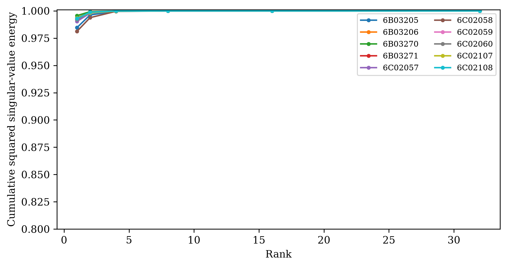

**Caption.** Cumulative singular-value energy of the ten raw spectral matrices.

**Interpretation.** Each curve uses every eighth recorded frame. The first four components account for more than 99.95% of the squared singular-value energy in every heat, supporting a rank-4 background.

**Source (relative to `problem1/`).** `v3/results/singular_energy.csv`

### Figure 5-2

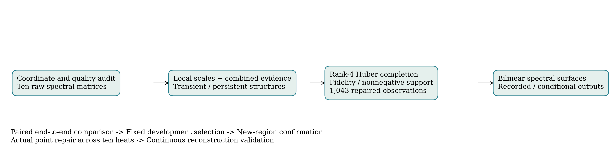

**Caption.** Workflow for adaptive anomaly identification, robust point repair, and continuous spectral reconstruction.

**Interpretation.** The stages connect actual-coordinate quality analysis, locally calibrated combined evidence, rank-4 Huber completion, and bilinear reconstruction. Recorded top codes and conditional estimates are stored separately.

**Source (relative to `problem1/`).** `final/src/detectors.py; v3/src/model3.py; v3/src/stable_completion.py; v3/src/interface.py`

### Figure 5-3

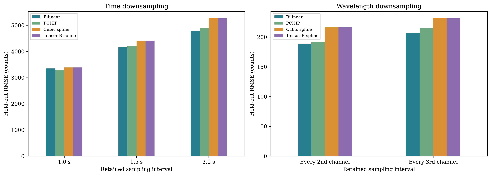

**Caption.** Held-out reconstruction errors under temporal and wavelength downsampling.

**Interpretation.** All methods use the same retained coordinates. Bilinear interpolation has the lowest development aggregate NRMSE and the lowest test RMSE at 1.5 s, 2.0 s, and both wavelength intervals; PCHIP is slightly more accurate at 1.0 s. Cubic spline and zero-smoothing tensor B-spline agree numerically in this configuration.

**Source (relative to `problem1/`).** `v2/results/interpolation_test.csv; v2/results/interpolation_independent_macro.csv`

### Figure 5-4

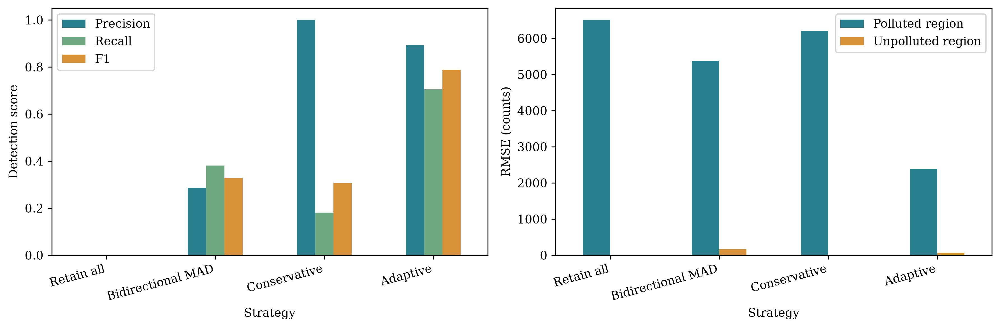

**Caption.** Anomaly detection and end-to-end repair under the paired contamination-confirmation protocol.

**Interpretation.** Detection scores use pooled TP, FP, and FN. RMSE is averaged within each heat and then across heats. The selected adaptive score achieves precision 89.31%, recall 70.52%, and F1 78.81%; the comparison uses the same 300-step solver budget for all strategies.

**Source (relative to `problem1/`).** `final/results/unified_comparison.csv: confirmation`

### Figure 5-5

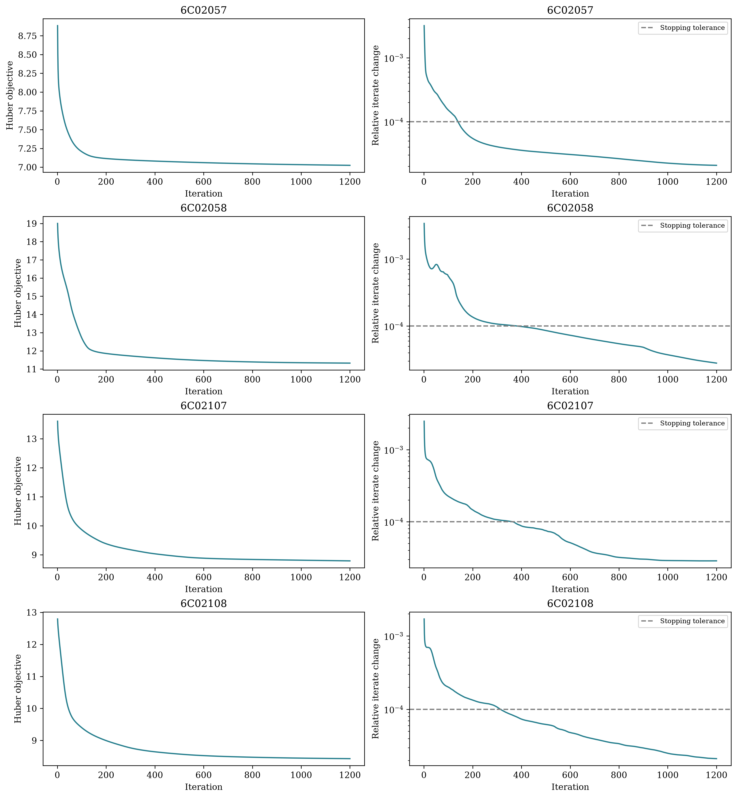

**Caption.** Huber objectives and relative iterate changes for four representative full-grid fits.

**Interpretation.** Rows correspond to Heats 6C02057, 6C02058, 6C02107, and 6C02108. Objectives and iterate changes come from the saved 1,200-step histories; the dashed line marks the fixed relative-change tolerance of 1e-4.

**Source (relative to `problem1/`).** `final/results/6C02057_solver.json; 6C02058_solver.json; 6C02107_solver.json; 6C02108_solver.json`

### Figure 5-6

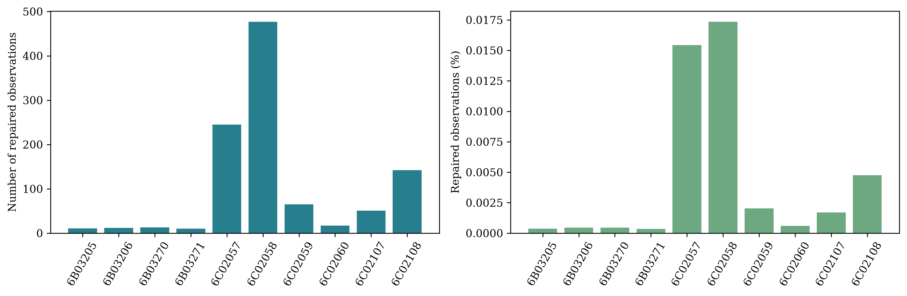

**Caption.** Numbers and percentages of actual point repairs across the ten heats.

**Interpretation.** There are 1,043 changed observations out of 27,816,683 records (0.00375%). The plots show actual exported changes, rather than candidate counts or injected anomalies.

**Source (relative to `problem1/`).** `final/results/final_summary.csv`

### Figure 5-7

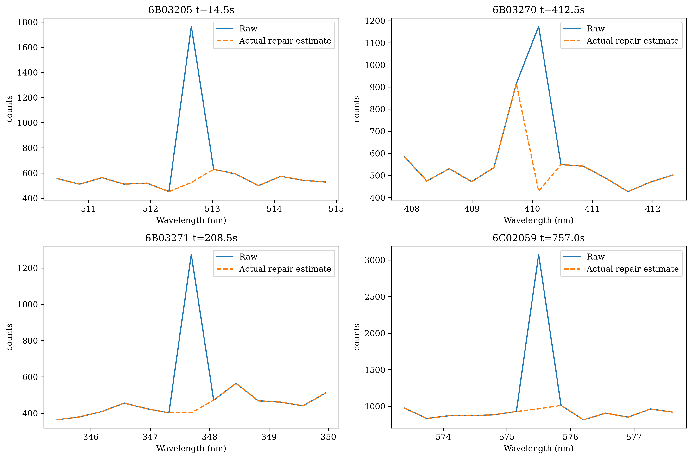

**Caption.** Measured and repaired local spectra at four reviewed statistical spikes.

**Interpretation.** The four locations are 6B03205 at 14.5 s and 512.659 nm; 6B03270 at 412.5 s and 410.105 nm; 6B03271 at 208.5 s and 347.691 nm; and 6C02059 at 757.0 s and 575.499 nm. The dashed curves are model-based repair estimates.

**Source (relative to `problem1/`).** `v3_1/results/high_confidence_statistical_points.csv; final/results/four_reviewed_actual_repairs.csv; final/data/*_interface.npz`

### Figure 5-8

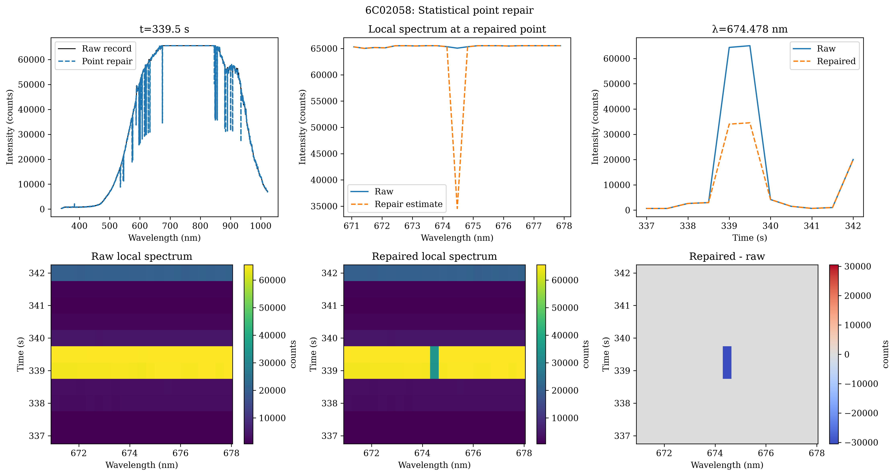

**Caption.** Local spectral and temporal evidence for a representative actual repair in Heat 6C02058.

**Interpretation.** The top row shows a full spectrum, its local wavelength neighborhood, and a time trace. The lower row compares the raw and repaired neighborhoods using shared intensity limits, followed by their signed difference. The example is the actual repair with the largest absolute change in this heat.

**Source (relative to `problem1/`).** `final/results/actual_repairs.csv; final/data/6C02058_interface.npz`

### Figure 5-9

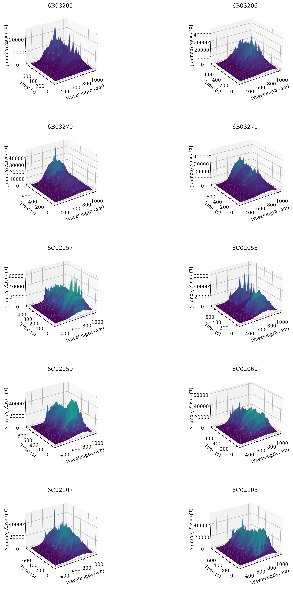

**Caption.** Recorded-scale reconstructed spectral surfaces for all ten heats.

**Interpretation.** Each panel uses the actual wavelength and time coordinates of one heat and the same intensity color scale from 0 to 65,535 counts. The plotting grid is thinned for readability; the continuous query interface retains the complete repaired node matrix.

**Source (relative to `problem1/`).** `final/data/*_interface.npz; v3/src/interface.py`

### Figure 5-10

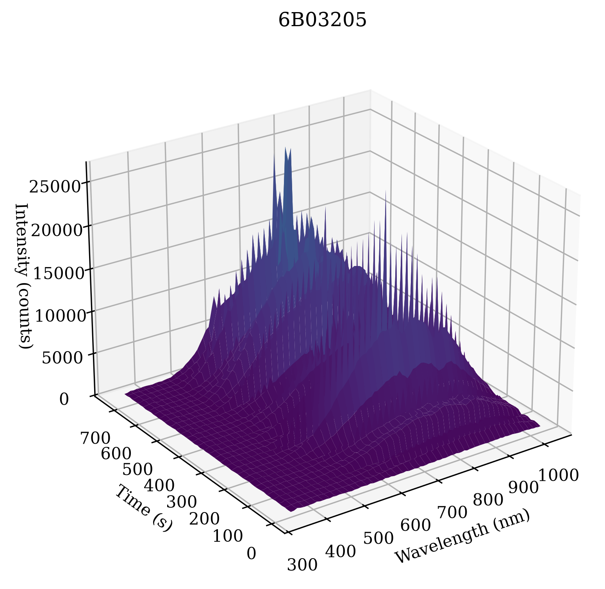

**Caption.** Recorded-scale continuous spectral surface for Heat 6B03205.

**Interpretation.** The node values are the frozen final repair result. Axes show wavelength (nm), relative time (s), and recorded intensity (counts); the bilinear function is defined on the actual observation domain.

**Source (relative to `problem1/`).** `final/data/6B03205_interface.npz; v3/src/interface.py`

### Figure 5-11

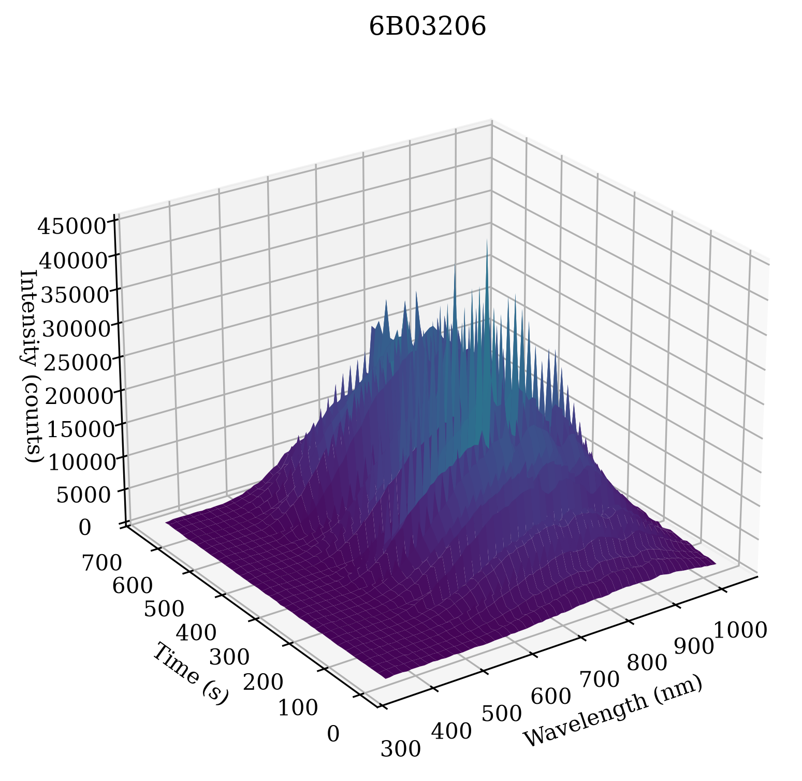

**Caption.** Recorded-scale continuous spectral surface for Heat 6B03206.

**Interpretation.** The node values are the frozen final repair result. Axes show wavelength (nm), relative time (s), and recorded intensity (counts); the bilinear function is defined on the actual observation domain.

**Source (relative to `problem1/`).** `final/data/6B03206_interface.npz; v3/src/interface.py`

### Figure 5-12

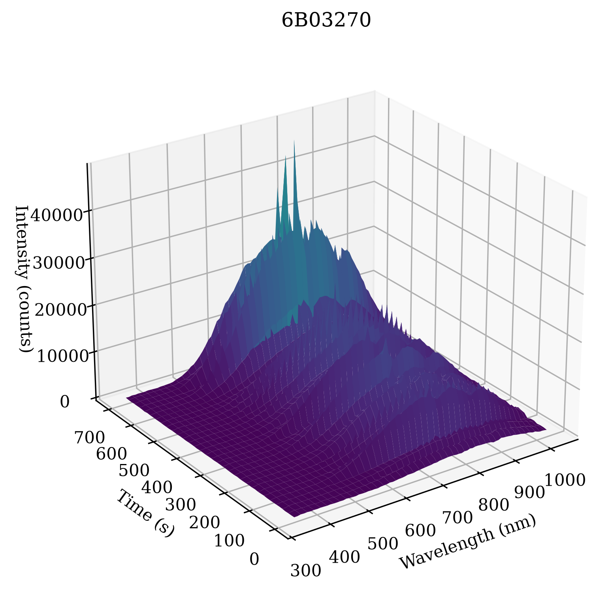

**Caption.** Recorded-scale continuous spectral surface for Heat 6B03270.

**Interpretation.** The node values are the frozen final repair result. Axes show wavelength (nm), relative time (s), and recorded intensity (counts); the bilinear function is defined on the actual observation domain.

**Source (relative to `problem1/`).** `final/data/6B03270_interface.npz; v3/src/interface.py`

### Figure 5-13

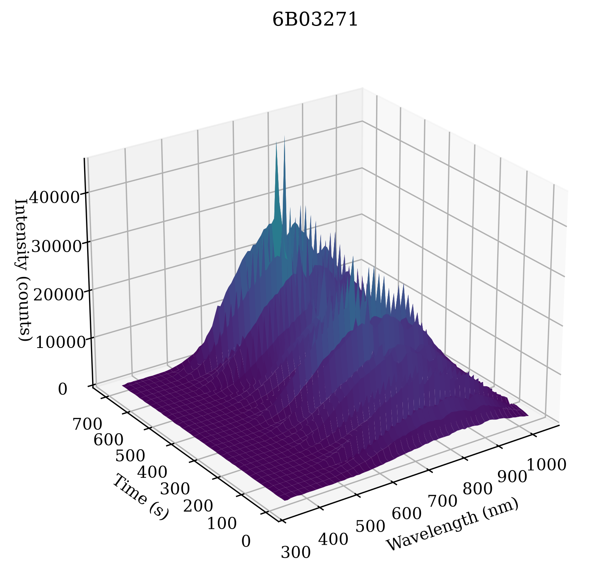

**Caption.** Recorded-scale continuous spectral surface for Heat 6B03271.

**Interpretation.** The node values are the frozen final repair result. Axes show wavelength (nm), relative time (s), and recorded intensity (counts); the bilinear function is defined on the actual observation domain.

**Source (relative to `problem1/`).** `final/data/6B03271_interface.npz; v3/src/interface.py`

### Figure 5-14

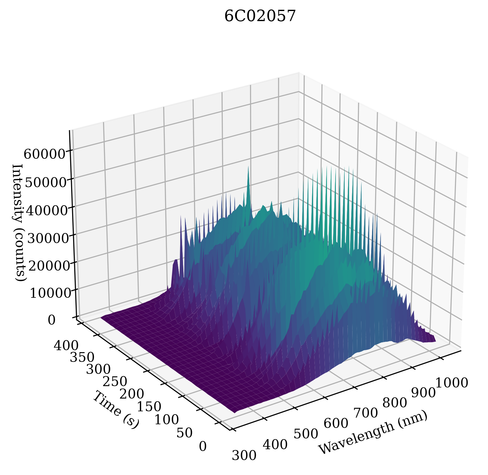

**Caption.** Recorded-scale continuous spectral surface for Heat 6C02057.

**Interpretation.** The node values are the frozen final repair result. Axes show wavelength (nm), relative time (s), and recorded intensity (counts); the bilinear function is defined on the actual observation domain.

**Source (relative to `problem1/`).** `final/data/6C02057_interface.npz; v3/src/interface.py`

### Figure 5-15

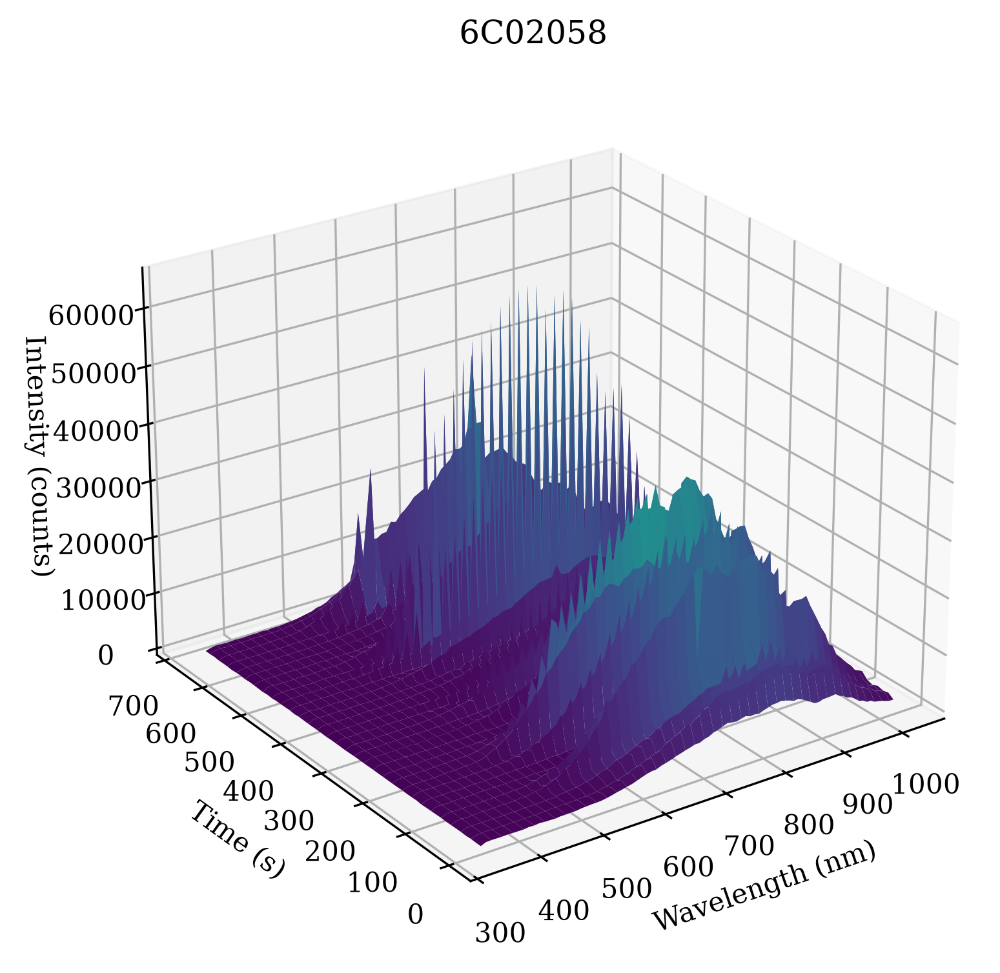

**Caption.** Recorded-scale continuous spectral surface for Heat 6C02058.

**Interpretation.** The node values are the frozen final repair result. Axes show wavelength (nm), relative time (s), and recorded intensity (counts); the bilinear function is defined on the actual observation domain.

**Source (relative to `problem1/`).** `final/data/6C02058_interface.npz; v3/src/interface.py`

### Figure 5-16

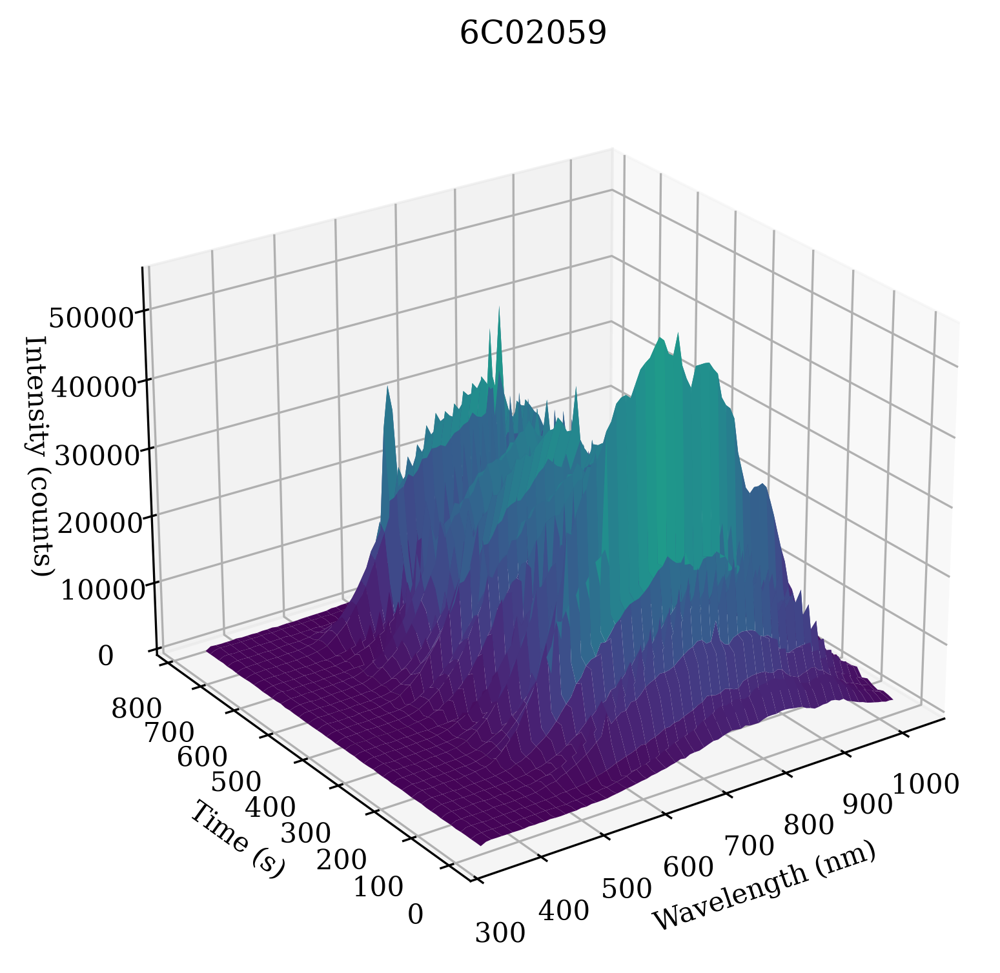

**Caption.** Recorded-scale continuous spectral surface for Heat 6C02059.

**Interpretation.** The node values are the frozen final repair result. Axes show wavelength (nm), relative time (s), and recorded intensity (counts); the bilinear function is defined on the actual observation domain.

**Source (relative to `problem1/`).** `final/data/6C02059_interface.npz; v3/src/interface.py`

### Figure 5-17

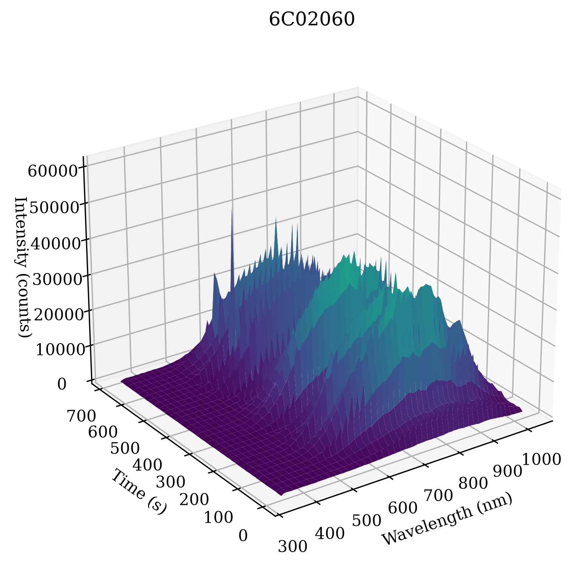

**Caption.** Recorded-scale continuous spectral surface for Heat 6C02060.

**Interpretation.** The node values are the frozen final repair result. Axes show wavelength (nm), relative time (s), and recorded intensity (counts); the bilinear function is defined on the actual observation domain.

**Source (relative to `problem1/`).** `final/data/6C02060_interface.npz; v3/src/interface.py`

### Figure 5-18

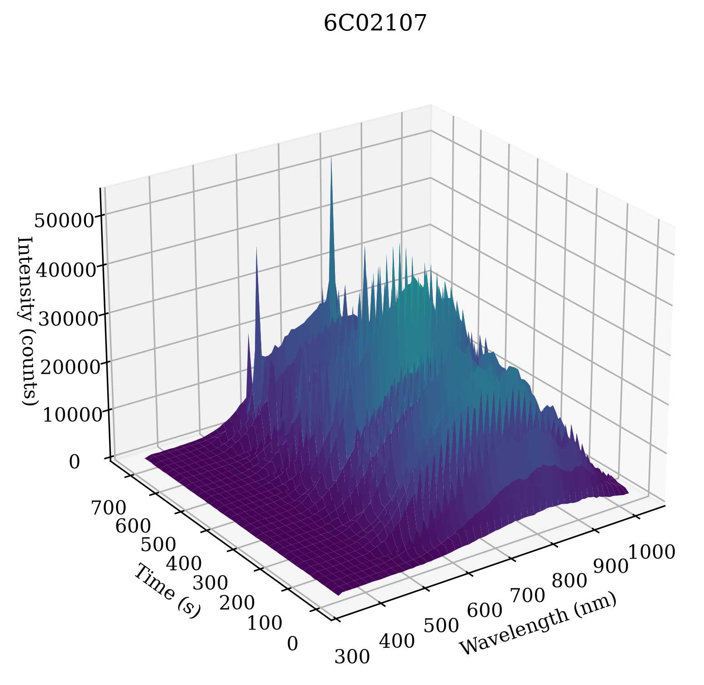

**Caption.** Recorded-scale continuous spectral surface for Heat 6C02107.

**Interpretation.** The node values are the frozen final repair result. Axes show wavelength (nm), relative time (s), and recorded intensity (counts); the bilinear function is defined on the actual observation domain.

**Source (relative to `problem1/`).** `final/data/6C02107_interface.npz; v3/src/interface.py`

### Figure 5-19

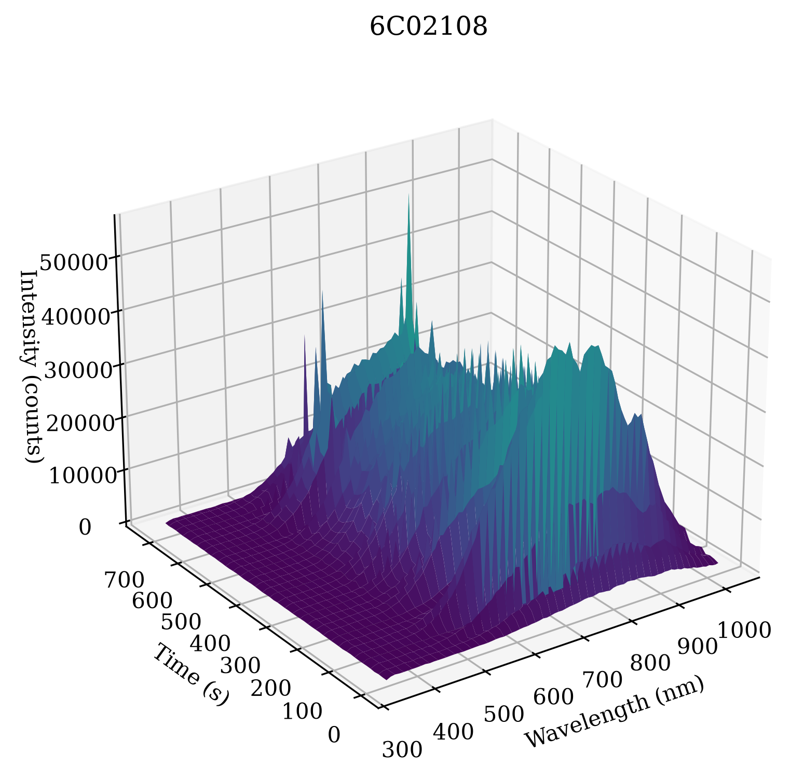

**Caption.** Recorded-scale continuous spectral surface for Heat 6C02108.

**Interpretation.** The node values are the frozen final repair result. Axes show wavelength (nm), relative time (s), and recorded intensity (counts); the bilinear function is defined on the actual observation domain.

**Source (relative to `problem1/`).** `final/data/6C02108_interface.npz; v3/src/interface.py`

## Supplementary per-heat evidence

The following panels use the same frozen data. The largest actual repair in each heat determines its local example. Rapid-transition spectra are selected using the saved frame diagnostics; no whole-frame deletion is introduced.

|Heat|Local repair|Full spectra and differences|Rapid transition|
|---|---|---|---|
|6B03205|[PNG](../figures/english/appendix/6B03205_repair_detail.png) / [SVG](../figures/english/appendix/6B03205_repair_detail.svg) / [PDF](../figures/english/appendix/6B03205_repair_detail.pdf)|[PNG](../figures/english/appendix/6B03205_full_spectrum_difference.png) / [SVG](../figures/english/appendix/6B03205_full_spectrum_difference.svg) / [PDF](../figures/english/appendix/6B03205_full_spectrum_difference.pdf)|[PNG](../figures/english/appendix/6B03205_rapid_transition.png) / [SVG](../figures/english/appendix/6B03205_rapid_transition.svg) / [PDF](../figures/english/appendix/6B03205_rapid_transition.pdf)|
|6B03206|[PNG](../figures/english/appendix/6B03206_repair_detail.png) / [SVG](../figures/english/appendix/6B03206_repair_detail.svg) / [PDF](../figures/english/appendix/6B03206_repair_detail.pdf)|[PNG](../figures/english/appendix/6B03206_full_spectrum_difference.png) / [SVG](../figures/english/appendix/6B03206_full_spectrum_difference.svg) / [PDF](../figures/english/appendix/6B03206_full_spectrum_difference.pdf)|[PNG](../figures/english/appendix/6B03206_rapid_transition.png) / [SVG](../figures/english/appendix/6B03206_rapid_transition.svg) / [PDF](../figures/english/appendix/6B03206_rapid_transition.pdf)|
|6B03270|[PNG](../figures/english/appendix/6B03270_repair_detail.png) / [SVG](../figures/english/appendix/6B03270_repair_detail.svg) / [PDF](../figures/english/appendix/6B03270_repair_detail.pdf)|[PNG](../figures/english/appendix/6B03270_full_spectrum_difference.png) / [SVG](../figures/english/appendix/6B03270_full_spectrum_difference.svg) / [PDF](../figures/english/appendix/6B03270_full_spectrum_difference.pdf)|[PNG](../figures/english/appendix/6B03270_rapid_transition.png) / [SVG](../figures/english/appendix/6B03270_rapid_transition.svg) / [PDF](../figures/english/appendix/6B03270_rapid_transition.pdf)|
|6B03271|[PNG](../figures/english/appendix/6B03271_repair_detail.png) / [SVG](../figures/english/appendix/6B03271_repair_detail.svg) / [PDF](../figures/english/appendix/6B03271_repair_detail.pdf)|[PNG](../figures/english/appendix/6B03271_full_spectrum_difference.png) / [SVG](../figures/english/appendix/6B03271_full_spectrum_difference.svg) / [PDF](../figures/english/appendix/6B03271_full_spectrum_difference.pdf)|[PNG](../figures/english/appendix/6B03271_rapid_transition.png) / [SVG](../figures/english/appendix/6B03271_rapid_transition.svg) / [PDF](../figures/english/appendix/6B03271_rapid_transition.pdf)|
|6C02057|[PNG](../figures/english/appendix/6C02057_repair_detail.png) / [SVG](../figures/english/appendix/6C02057_repair_detail.svg) / [PDF](../figures/english/appendix/6C02057_repair_detail.pdf)|[PNG](../figures/english/appendix/6C02057_full_spectrum_difference.png) / [SVG](../figures/english/appendix/6C02057_full_spectrum_difference.svg) / [PDF](../figures/english/appendix/6C02057_full_spectrum_difference.pdf)|[PNG](../figures/english/appendix/6C02057_rapid_transition.png) / [SVG](../figures/english/appendix/6C02057_rapid_transition.svg) / [PDF](../figures/english/appendix/6C02057_rapid_transition.pdf)|
|6C02058|[PNG](../figures/english/appendix/6C02058_repair_detail.png) / [SVG](../figures/english/appendix/6C02058_repair_detail.svg) / [PDF](../figures/english/appendix/6C02058_repair_detail.pdf)|[PNG](../figures/english/appendix/6C02058_full_spectrum_difference.png) / [SVG](../figures/english/appendix/6C02058_full_spectrum_difference.svg) / [PDF](../figures/english/appendix/6C02058_full_spectrum_difference.pdf)|[PNG](../figures/english/appendix/6C02058_rapid_transition.png) / [SVG](../figures/english/appendix/6C02058_rapid_transition.svg) / [PDF](../figures/english/appendix/6C02058_rapid_transition.pdf)|
|6C02059|[PNG](../figures/english/appendix/6C02059_repair_detail.png) / [SVG](../figures/english/appendix/6C02059_repair_detail.svg) / [PDF](../figures/english/appendix/6C02059_repair_detail.pdf)|[PNG](../figures/english/appendix/6C02059_full_spectrum_difference.png) / [SVG](../figures/english/appendix/6C02059_full_spectrum_difference.svg) / [PDF](../figures/english/appendix/6C02059_full_spectrum_difference.pdf)|[PNG](../figures/english/appendix/6C02059_rapid_transition.png) / [SVG](../figures/english/appendix/6C02059_rapid_transition.svg) / [PDF](../figures/english/appendix/6C02059_rapid_transition.pdf)|
|6C02060|[PNG](../figures/english/appendix/6C02060_repair_detail.png) / [SVG](../figures/english/appendix/6C02060_repair_detail.svg) / [PDF](../figures/english/appendix/6C02060_repair_detail.pdf)|[PNG](../figures/english/appendix/6C02060_full_spectrum_difference.png) / [SVG](../figures/english/appendix/6C02060_full_spectrum_difference.svg) / [PDF](../figures/english/appendix/6C02060_full_spectrum_difference.pdf)|[PNG](../figures/english/appendix/6C02060_rapid_transition.png) / [SVG](../figures/english/appendix/6C02060_rapid_transition.svg) / [PDF](../figures/english/appendix/6C02060_rapid_transition.pdf)|
|6C02107|[PNG](../figures/english/appendix/6C02107_repair_detail.png) / [SVG](../figures/english/appendix/6C02107_repair_detail.svg) / [PDF](../figures/english/appendix/6C02107_repair_detail.pdf)|[PNG](../figures/english/appendix/6C02107_full_spectrum_difference.png) / [SVG](../figures/english/appendix/6C02107_full_spectrum_difference.svg) / [PDF](../figures/english/appendix/6C02107_full_spectrum_difference.pdf)|[PNG](../figures/english/appendix/6C02107_rapid_transition.png) / [SVG](../figures/english/appendix/6C02107_rapid_transition.svg) / [PDF](../figures/english/appendix/6C02107_rapid_transition.pdf)|
|6C02108|[PNG](../figures/english/appendix/6C02108_repair_detail.png) / [SVG](../figures/english/appendix/6C02108_repair_detail.svg) / [PDF](../figures/english/appendix/6C02108_repair_detail.pdf)|[PNG](../figures/english/appendix/6C02108_full_spectrum_difference.png) / [SVG](../figures/english/appendix/6C02108_full_spectrum_difference.svg) / [PDF](../figures/english/appendix/6C02108_full_spectrum_difference.pdf)|[PNG](../figures/english/appendix/6C02108_rapid_transition.png) / [SVG](../figures/english/appendix/6C02108_rapid_transition.svg) / [PDF](../figures/english/appendix/6C02108_rapid_transition.pdf)|

### Wavelength-region comparison

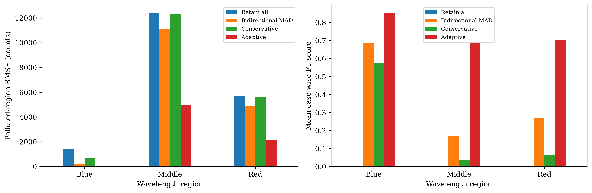

**Caption.** Repair RMSE and mean case-wise F1 in blue, middle, and red wavelength regions under the common contamination-confirmation protocol.

**Interpretation.** Regional values come from the saved per-heat, per-region results. Case-wise F1 averages in this panel have a different aggregation definition from pooled F1 in Figure 5-4.

**Source.** `final/results/confirmation_per_heat_band.csv`. [SVG](../figures/english/main/wavelength_region_comparison.svg) / [PDF](../figures/english/main/wavelength_region_comparison.pdf).

## Reproduction and checks

From the repository root, using the existing environment and frozen local data:

```bash
OPENBLAS_NUM_THREADS=1 OMP_NUM_THREADS=1 .venv/bin/python problem1/final/src/plots_english.py
.venv/bin/python problem1/final/src/english_figure_report.py
```

The renderer checks every visible Matplotlib text item and every SVG for CJK characters. The original figures, numerical arrays, parameters, and experiment tables are preserved. Spatial/temporal repair panels retain their original example-selection rule. The English convergence figure includes the saved objectives as well as relative changes, and the interpolation comparison separates time and wavelength panels for legibility.
