# 5 问题一：基于自适应多证据与鲁棒低秩补全的火焰光谱连续重构

## 5.1 光谱数据分析

火焰光谱同时包含冶炼过程的整体辐射变化和不同波长上的局部谱线结构。为从离散记录建立连续曲面，首先按附件实际时间、波长表头组织每炉数据，记光谱矩阵为 $Y=(Y_{ij})\in\mathbb R^{n\times m}$，其中 $Y_{ij}$ 表示时刻 $t_i$、波长 $\lambda_j$ 处的记录光强，单位为 counts。十炉共有13,589帧、27,816,683个观测，每帧均为2047通道，时间间隔为0.5 s；波长坐标严格递增，但间距并不均匀。各炉采集时长与波长范围见表5-1。后续局部预测、积分计算及连续插值均使用实际坐标，从而将通道间距和各炉时长差异纳入模型。

表5-1　十炉光谱的实际坐标及矩阵规模

|炉次|时间区间/s|矩阵维数|波长区间/nm|疑似顶码数|
|---|---|---|---|---|
|6B03205|[0, 739]|1479×2047|[340.535, 1027.963]|0|
|6B03206|[0, 655]|1311×2047|[340.535, 1027.963]|13|
|6B03270|[0, 706]|1413×2047|[340.535, 1027.963]|0|
|6B03271|[0, 709.5]|1420×2047|[340.535, 1027.963]|10|
|6C02057|[0, 387]|775×2047|[339.390, 1023.303]|4168|
|6C02058|[0, 671]|1343×2047|[339.390, 1023.303]|5805|
|6C02059|[0, 777]|1555×2047|[339.390, 1023.303]|100|
|6C02060|[0, 686]|1373×2047|[339.390, 1023.303]|326|
|6C02107|[0, 729]|1459×2047|[339.390, 1023.303]|2110|
|6C02108|[0, 730]|1461×2047|[339.390, 1023.303]|2273|

对数据结构进行逐项检查，原始矩阵均无非有限值、负值和全零帧。因此，本问预处理的重点是识别数值有效但局部结构不一致的观测，而不是填补文件读取产生的空缺。光强随冶炼阶段和波长区域显著变化：宽带背景决定全谱亮度，持续谱线表现为相邻时刻同一波长附近的共同增强，局部尖峰和突降则表现为少量节点相对周围结构的突出偏离。这些现象提示，异常程度应相对于局部变化尺度衡量，并同时利用时间与波长两种邻域。

表5-2　光强分布与双向相邻相关性

|炉次|光强中位数/counts|99%分位/counts|时间相邻相关|波长相邻相关|
|---|---|---|---|---|
|6B03205|2504|17315|0.8538|0.999529|
|6B03206|4917|28307|0.8539|0.999648|
|6B03270|4364|24445|0.8448|0.999633|
|6B03271|4705|23999|0.8506|0.999607|
|6C02057|7724|50833|0.7482|0.999706|
|6C02058|3112|53818|0.5945|0.999799|
|6C02059|6569|38498|0.8560|0.999677|
|6C02060|6938|42641|0.8173|0.999683|
|6C02107|7015|41072|0.7658|0.999630|
|6C02108|7783|39757|0.8391|0.999653|

光强中位数为2504–7783 counts，而99%分位为17315–53818 counts，表明分布存在明显高强度尾部。相邻波长相关系数均高于0.9995；相邻时间相关系数为0.5945–0.8560，6C02058的时间相关性最低。相关系数由实际相邻对展平计算，分别在波长或时间上隔4个位置抽取；统计口径在各炉保持一致。强波长相关支持利用邻通道及低秩共同结构，较弱且炉次不均的时间相关则提示采用局部适应尺度，保留真实快速变化。

区域尺度对照进一步说明了自适应处理的必要性。在既有局部片段诊断中，一组蓝端片段的平均95%–5%分位范围约为203.9 counts，另一组片段达到19,848.7 counts；注入异常幅度约增长5.3倍，而时间方向标准化残差中位数由35.34降为3.06。采用各项证据必须分别越过固定阈值的判定方式时，时间证据通过率由68.69%降至18.81%，双向参考一致性通过率由97.00%降至37.13%。这表明区域背景波动和多个硬条件的交集是漏检的重要来源。因此，本文将局部尺度校准与多证据软融合结合，使检测标准随背景波动调整。

时间相关性与波长相关性具有不同含义。相邻帧共享冶炼背景和主要辐射结构，相邻波长则共同描述谱峰、带状辐射及连续背景。真实窄谱线可以在波长方向具有很大偏差，但通常在相邻时刻保持位置或增强趋势；孤立污染往往同时破坏时间连续性和局部光谱形状。对这两种情况的区分，是持续谱线保护与异常修复集合构造的依据。

为考察全局相关结构，对原始记录沿时间每隔8帧取样，进行描述性奇异值分解

$$
Y_s=U_s\Sigma V_s^{\mathsf T},\qquad
E(r)=\frac{\sum_{k=1}^{r}\sigma_k^2}{\sum_{k=1}^{\min(n_s,m)}\sigma_k^2}.
\tag{5-1}
$$

十炉的前四阶能量均超过99.95%，见表5-3和图5-1。少数共同成分能够表达整体亮度及主要光谱形状，为秩4背景及补全模型提供数据依据。与此同时，低能量细节仍可能对应真实谱线，所以低秩矩阵用于估计被掩码节点，正式结果通过观测保真保留其余节点的细节。

表5-3　原始记录矩阵的前四阶累计奇异值能量

|炉次|前四阶能量/%|炉次|前四阶能量/%|
|---|---|---|---|
|6B03205|99.9524|6C02058|99.9594|
|6B03206|99.9823|6C02059|99.9785|
|6B03270|99.9861|6C02060|99.9783|
|6B03271|99.9824|6C02107|99.9774|
|6C02057|99.9761|6C02108|99.9875|

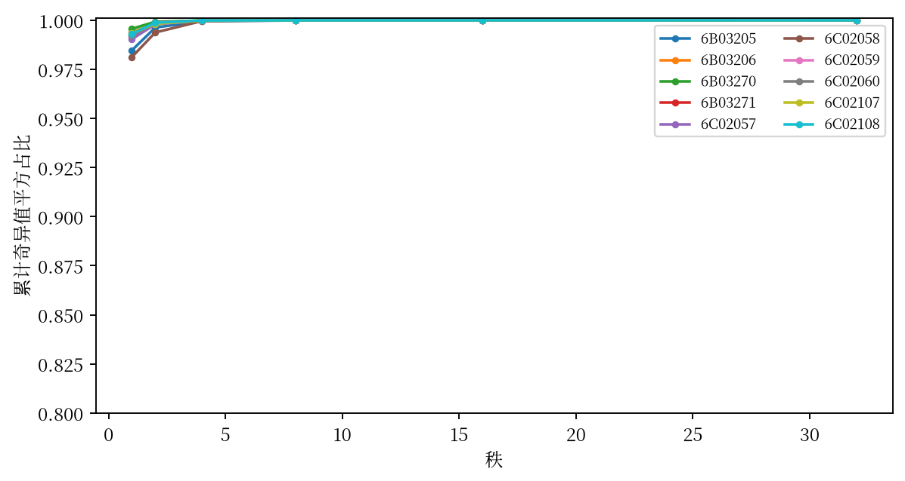

图5-1　十炉奇异值能量贡献率。

另有八炉出现重复记录65535的区域，共14,805点。65535等于16位无符号记录的最大整数，结合USB4000技术手册的16位模数转换说明[1–2]，将这些位置标记为疑似上量程截顶。它们集中于高强度区域，与一般孤立尖峰具有不同观测机制。由此建立两个相互配合的输出：记录尺度上的连续光谱保留顶码信息，条件性潜在光谱则在上量程截顶假设下引入下界约束。

## 5.2 数据预处理与异常识别

### 5.2.1 异常类型与数据质量分析

根据影响范围及邻域表现，将数据质量问题分为孤立尖峰或突降、短时局部块变化、整帧亮度或形状变化、持续通道偏离和疑似截顶。持续谱线及真实工艺突变作为需要保护的信号结构。局部异常通过多证据评分形成修复集合；大范围帧变化和持续通道变化结合全谱积分、光谱角、归一化形状、持续长度和低秩残差进行诊断；疑似截顶独立进入量程处理分支。

全谱积分采用实际波长上的梯形公式

$$
I_i=\sum_{j=1}^{m-1}\frac{Y_{ij}+Y_{i,j+1}}{2}(\lambda_{j+1}-\lambda_j).
\tag{5-2}
$$

将待分析帧排除后，由邻域帧构造参考谱 $r_i$，再计算亮度相对偏差、光谱角 $\theta_i=\arccos\{\langle Y_i,r_i\rangle/(\|Y_i\|_2\|r_i\|_2)\}$ 和归一化形状残差。整体亮度突变而归一化形状相近，主要表现为幅度变化；光谱角和形状残差同时升高，则表明结构发生变化。最终对1129个帧级候选保留诊断信息，局部点修复与宏观工艺变化分别处理。

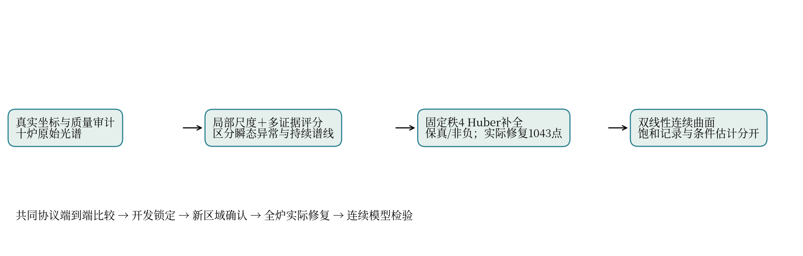

图5-2　第一问整体技术路线。

### 5.2.2 双向局部预测及自适应尺度估计

传统双向MAD使用时间与波长方向的局部中位数构造残差，再要求两方向得分同时超过阈值。该方法能够识别明显孤立偏离，但相邻污染会改变局部尺度，真实窄谱线也会产生较大的波长残差。为充分利用实际坐标，本文先构造不含当前点的双向线性预测参考。记 $Z$ 为顶码和数值无效位置经过可见数据双向填充得到的检测工作矩阵；在普通观测位置有 $Z_{ij}=Y_{ij}$。对内部节点，令

$$
\begin{aligned}
R^t_{ij}&=(1-a_i)Z_{i-1,j}+a_iZ_{i+1,j},
&a_i&=\frac{t_i-t_{i-1}}{t_{i+1}-t_{i-1}},\\
R^\lambda_{ij}&=(1-b_j)Z_{i,j-1}+b_jZ_{i,j+1},
&b_j&=\frac{\lambda_j-\lambda_{j-1}}{\lambda_{j+1}-\lambda_{j-1}}.
\end{aligned}
\tag{5-3}
$$

这两个参考分别回答“相邻时刻在该波长的变化能否解释当前记录”以及“相邻波长能否解释当前局部形状”。定义预测残差 $e^t=Z-R^t$、$e^\lambda=Z-R^\lambda$，选取偏移集合 $K=\{-4,-3,-2,2,3,4\}$，以邻近残差的绝对值中位数估计变化尺度：

$$
\begin{aligned}
s^t_{ij}&=\max\left\{25,1.4826\operatorname{med}_{k\in K}|e^t_{i+k,j}|\right\},\\
s^\lambda_{ij}&=\max\left\{25,1.4826\operatorname{med}_{k\in K}|e^\lambda_{i,j+k}|\right\},\\
z^t_{ij}&=|e^t_{ij}|/s^t_{ij},\qquad
z^\lambda_{ij}=|e^\lambda_{ij}|/s^\lambda_{ij}.
\end{aligned}
\tag{5-4}
$$

系数1.4826沿用MAD的尺度校准；此处直接作用于近似居中的预测残差。跳过偏移0和紧邻位置，可以减轻当前孤立扰动及其邻接预测残差对尺度的影响。25 counts的下限为低波动、量化邻域提供稳定分母。由此，大幅波动区域与低强度区域均以各自的背景变化为参照，得分转化为无量纲证据。

### 5.2.3 多证据联合异常评分模型

双向预测关注局部结构，低秩背景补充整炉共同变化信息。先用窗口5、阈值6的双向MAD获得初步可见集合，对掩码位置作双向填充，再经秩4投影得到背景 $B$。该背景仅用于异常评分。令 $E=Z-B$，以 $9\times9$ 中位数算子 $\mathcal M_9$ 定义

$$
m^L=\mathcal M_9(E),\qquad
s^L=\max\{50,1.4826\mathcal M_9(|E-m^L|)\},\qquad
z^L=|E-m^L|/s^L.
\tag{5-5}
$$

这里第二次中位数作用于各位置相对其局部中心的绝对残差，50 counts为背景残差尺度下限。$z^L$ 衡量节点相对于低秩背景及局部残差中心的偏离。

为保护持续谱线，先计算相对5通道中位数的谱线显著性 $p_{ij}=Z_{ij}-\mathcal M_{\lambda,5}(Z)_{ij}$，再统计前后两帧中显著性同号且幅度不低于当前一半的次数：

$$
P_{ij}=\sum_{k\in\{-2,-1,1,2\}}
\mathbf 1\{p_{i+k,j}p_{ij}>0,\ |p_{i+k,j}|\geq\tfrac12|p_{ij}|\}.
\tag{5-6}
$$

$P_{ij}\in\{0,1,2,3,4\}$ 越大，当前尖锐结构越可能具有时间持续性，其波长异常证据按 $1+P_{ij}$ 衰减。另一方面，真实曲率或快速变化会使时间与波长两个参考存在差异。定义参考一致性权重

$$
c_{ij}=\left[1+
\frac{|R^t_{ij}-R^\lambda_{ij}|}
{\max\{50,0.2|R^t_{ij}|\}+s^t_{ij}+s^\lambda_{ij}}
\right]^{-1}.
\tag{5-7}
$$

当两种参考接近时，$c_{ij}$ 接近1；参考分歧增大时，评分被连续下调。最终综合评分为

$$
\mathcal S_{ij}=c_{ij}\sqrt{z^t_{ij}
\left(\frac{z^\lambda_{ij}}{2(1+P_{ij})}+\frac{z^L_{ij}}2\right)}.
\tag{5-8}
$$

式(5-8)以时间偏离为共同基础，使波长形状与低秩背景两种证据互为补充；持续性和一致性通过软权重发挥作用。相比多个固定阈值的交集，该形式允许某一种支持证据较弱时，由另一种结构证据补充。它是依据本题数据构造的综合异常程度，不赋予其仪器故障概率的含义。

### 5.2.4 异常判定与分类处理策略

评分阈值仅比较4和6两种方案，根据开发片段上的端到端误差与结构保持效果确定阈值4。对 $\mathcal S_{ij}\geq4$ 的候选进行8连通区域分析，自动点修复限于时间跨度不超过3个采样点、波长跨度不超过7个通道的区域。边缘4个节点和顶码的 $3\times3$ 邻域不进入该自动点修复规则，分别保留边界及量程标记。评分不低于2、但未纳入修复集合的位置保存为一般疑似点。

将最终局部修复集合记为 $\mathcal A$。四个经邻域曲线复核的高证据尖峰均由评分重新识别并纳入 $\mathcal A$；对6C02108在304.0 s、766.413 nm处的持续谱线，则结合前后帧和邻通道共同增强保留原记录。处理结果形成“有效保留—疑似保留—统计修复”三级质量信息，截顶标记与三级信息并行保存。统计修复集合对应局部连续性假设下的估计对象。

检测与修复通过掩码明确衔接：$\mathcal A$ 内原始数值在低秩拟合输入中置为不可见，疑似点与其余正常记录继续可见；顶码位置进入独立约束分支。这样，异常值不会以原幅度继续影响其自身的补全结果，整帧亮度和持续通道变化又能保留完整的过程信息。

## 5.3 鲁棒低秩异常修复模型建立

### 5.3.1 光谱观测模型及可见集合

设潜在光谱强度为 $F(t_i,\lambda_j)$，普通测量扰动为 $\varepsilon_{ij}$，局部异常扰动为 $O_{ij}$。考虑量化和上量程限制，观测关系写为

$$
Y_{ij}=\mathcal Q\left(\min\{U,\max[0,F(t_i,\lambda_j)+\varepsilon_{ij}+O_{ij}]\}\right),\qquad U=65535.
\tag{5-9}
$$

$\mathcal Q$ 表示记录量化。定义疑似截顶集 $\Omega_s=\{(i,j):Y_{ij}=U\}$、拟合可见集 $\Omega_v=\{Y_{ij}\text{有限且非负}\}\setminus(\mathcal A\cup\Omega_s)$，以及记录保留集 $\Omega_o=\Omega_v\cup\Omega_s$。前者决定低秩拟合使用哪些普通观测，后者决定哪些节点在正式记录尺度结果中按原值保留。

为统一损失尺度，令 $Z^o=Y/U$，以无量纲矩阵 $L$ 表示低秩潜变量。$UL$ 给出由全局结构推断的光强，正式修复矩阵记为 $D$。两者分别承担结构估计与最终节点表达的功能。

### 5.3.2 固定秩Huber鲁棒矩阵补全

奇异值能量分析表明，秩4足以表达主要共同变化；对余下局部偏离使用Huber损失控制影响。建立

$$
\min_{\operatorname{rank}(L)\leq4}
\Phi(L)=\sum_{(i,j)\in\Omega_v}h_\eta(L_{ij}-Z^o_{ij}),\qquad\eta=0.003,
\tag{5-10}
$$

其中

$$
h_\eta(u)=
\begin{cases}
\tfrac12u^2,&|u|\leq\eta,\\
\eta|u|-\tfrac12\eta^2,&|u|>\eta.
\end{cases}
\tag{5-11}
$$

小残差采用二次惩罚以充分利用普通观测，大残差采用线性增长以限制残留污染对共同结构的牵引。归一化阈值0.003对应196.605 counts。稳健估计及低秩恢复研究提供了有界影响和共同结构恢复的数学依据[3–5]；本模型具体采用固定秩与Huber损失的组合。

Huber损失还可通过辅助稀疏变量解释。对任意残差 $u$，有

$$
h_\eta(u)=\min_e\left\{\tfrac12(u-e)^2+\eta|e|\right\},\qquad
e^*=\operatorname{soft}(u,\eta),
\tag{5-12}
$$

其中 $\operatorname{soft}(u,\eta)=\operatorname{sign}(u)(|u|-\eta)_+$。因此式(5-10)等价于

$$
\min_{\operatorname{rank}(L)\leq4,E^{sp}}
\frac12\|\mathcal P_{\Omega_v}(L-Z^o-E^{sp})\|_F^2
+\eta\|\mathcal P_{\Omega_v}E^{sp}\|_1.
\tag{5-13}
$$

对 $E^{sp}$ 消元即得到式(5-10)。辅助变量吸收大残差部分，解释了鲁棒拟合中低秩与稀疏偏离的分工；实际求解直接使用Huber梯度。异常掩码首先移除已判定的局部污染，Huber损失随后降低其余偏离的影响，两者作用于不同环节。

### 5.3.3 观测保真与局部非负支撑约束

低秩结构适合推断被掩码节点，原始有效观测则保留了真实的局部光谱细节。对修复位置沿时间和波长方向寻找最近的可见记录作为轴向支撑，记其集合为 $\mathcal N_{ij}$，包括保留的顶码记录。构造

$$
\ell_{ij}=\max\{0,\min_{(a,b)\in\mathcal N_{ij}}Y_{ab}\},\qquad
u_{ij}=\max_{(a,b)\in\mathcal N_{ij}}Y_{ab}.
\tag{5-14}
$$

以 $\widetilde L$ 表示经第5.4节稳定性处理后的补全估计，正式矩阵为

$$
D_{ij}=
\begin{cases}
Y_{ij},&(i,j)\in\Omega_o,\\
\Pi_{[\ell_{ij},u_{ij}]}(U\widetilde L_{ij}),&(i,j)\in\mathcal A,
\end{cases}
\quad
\Pi_{[\ell,u]}(x)=\min\{u,\max(\ell,x)\}.
\tag{5-15}
$$

该操作是具有闭式解的局部箱约束投影：$\Pi_{[\ell,u]}(x)=\arg\min_{d\in[\ell,u]}(d-x)^2$。下界落实非负性，上界及局部下界将孤立修复限制在相邻可见结构的支撑范围内。若缺少轴向支撑，采用可见记录的整体范围并保存弱支撑标记。

观测保真决定 $D$ 在保留位置等于原记录；局部支撑决定被修复位置的可行强度。由此，潜变量的整体结构与节点上的真实细节相结合，最终 $D$ 保留原始有效谱线，且所有节点非负。验证时，缺失或污染节点用于评价预测，保留节点的相等关系用于检查保真性质。

### 5.3.4 疑似饱和光谱的条件性估计

记录尺度结果在 $\Omega_s$ 上取 $D_{ij}=U$，同时保存截顶和不可辨识标记。在上量程截顶机制成立的条件下，潜在强度满足 $F(t_i,\lambda_j)\geq U$，因而另设条件性估计矩阵。采用带边界扩展的局部块，对归一化变量 $X$ 求解

$$
\min_X\ \frac12\|\mathcal P_{\Omega_v}(X-Z^o)\|_F^2+\tau\|X\|_*,
\qquad X_{ij}\geq1\quad((i,j)\in\Omega_s),\quad\tau=0.01.
\tag{5-16}
$$

核范数 $\|X\|_*=\sum_k\sigma_k(X)$ 鼓励局部共同结构，下界约束使截顶记录在每一步求解中作为受限观测参与估计。各块以 $96\times192$ 为核心区，并向时间、波长方向分别扩展8和16个节点；估计结果仅在核心区的截顶位置回填。该分支采用核范数凸模型，普通异常点修复仍采用式(5-10)的固定秩模型。

最终分别保存记录曲面与条件性估计：前者表达仪器记录尺度上的光谱，后者表达截顶假设下、由邻域与低秩先验支持的潜在强度。两种输出共享实际坐标和质量掩码，超量程估计以模型估计标识保存。

## 5.4 模型求解

式(5-10)采用投影梯度法。首先，仅使用 $\Omega_v$ 上的数值，分别沿时间与波长作实际坐标线性填充；两方向均可用时取均值，单方向可用时采用该方向结果，均不可用时采用可见记录的中位数。保留节点在初始化填充中取原值，再对归一化结果作秩4投影得到 $L^{(0)}$。

Huber损失的导数为 $h'_\eta(u)=\operatorname{clip}(u,-\eta,\eta)$，故梯度为

$$
G^{(k)}=\mathcal P_{\Omega_v}\left[\operatorname{clip}(L^{(k)}-Z^o,-\eta,\eta)\right].
\tag{5-17}
$$

对步长 $\alpha_k$，先沿负梯度移动，再投影回秩4集合：

$$
L^{(k+1)}=\mathcal P_4(L^{(k)}-\alpha_kG^{(k)}),\qquad
\mathcal P_4(A)=U_4\Sigma_4V_4^{\mathsf T}.
\tag{5-18}
$$

截断SVD保留最大四个奇异值及对应向量，是Frobenius范数意义下的最佳秩4近似；大矩阵以固定随机种子的随机截断SVD实现该投影。每次迭代从当前步长开始回溯，以 $\Phi(L^{(k+1)})\leq\Phi(L^{(k)})+10^{-12}$ 为接受条件，最多尝试12次，每次将步长减半；接受后将下一次步长放大1.1倍，且不超过1。该过程同时利用有界梯度与目标函数下降控制更新。

相对迭代变化率定义为

$$
\delta_k=\frac{\|L^{(k+1)}-L^{(k)}\|_F}{\max\{\|L^{(k)}\|_F,10^{-12}\}},\qquad\delta_k<10^{-4}.
\tag{5-19}
$$

完整炉次计算保存第600和1200步的估计，并在固定迭代及时间预算内检查输出稳定性。对两个检查点先作观测保真和局部支撑投影，得到 $D^{[600]},D^{[1200]}$。当待修复位置满足 $|D^{[1200]}_{ij}-D^{[600]}_{ij}|>65.535$ counts时，采用仅依赖可见记录和保留顶码的双向线性估计作为该位置的数值回退；若预算内未形成第600步检查点，也按此规则回退。随后保留对应质量标记。这个局部回退在节点输出阶段执行，使固定预算下的正式结果具有明确的稳定性处理。

对于式(5-16)，引入 $X=H$，令 $H$ 承担核范数项，$V$ 为缩放对偶变量，$M$ 为可见集合的0–1矩阵。ADMM迭代为

$$
\begin{aligned}
X^{(k+1)}&=\frac{M\odot Z^o+\rho(H^{(k)}-V^{(k)})}{M+\rho},\\
X^{(k+1)}_{\Omega_s}&\leftarrow\max\{1,X^{(k+1)}_{\Omega_s}\},\\
H^{(k+1)}&=\operatorname{SVT}_{\tau/\rho}(X^{(k+1)}+V^{(k)}),\\
V^{(k+1)}&=V^{(k)}+X^{(k+1)}-H^{(k+1)},
\end{aligned}
\tag{5-20}
$$

第一式逐元素相除；$\operatorname{SVT}_a$ 将各奇异值替换为 $(\sigma-a)_+$。$X$ 子问题为带逐点下界的可分二次问题，第二式即其精确约束解；$H$ 子问题由核范数的近端算子求解。取 $\rho=1$，归一化原始残差 $\|X-H\|_F/\max(\|X\|_F,10^{-12})$ 和对偶残差 $\rho\|H^{(k+1)}-H^{(k)}\|_F/\max(\|X\|_F,10^{-12})$ 均低于 $10^{-4}$ 时停止，迭代上限300。

**算法5-1　自适应多证据识别与鲁棒低秩连续重构**

```text
输入：原始矩阵Y，实际时间t及波长λ，固定参数表
1  检查坐标及数值，标记疑似顶码Ωs，生成检测工作矩阵Z
2  按式(5-3)–(5-8)计算双向证据、低秩证据及综合评分
3  对评分候选作连通分析和局部复核，形成修复集合A与可见集Ωv
4  以Ωv上的数据双向填充，截断SVD得到初值L(0)
5  重复：计算Huber梯度 → 回溯步长 → 秩4投影 → 保存目标及变化率
6  保存600/1200步检查点；对待修复节点作局部支撑及稳定性处理
7  在Ωo保留原值，输出非负修复矩阵D及各类质量标记
8  对含顶码局部块执行ADMM，另存条件性估计与下界检查结果
9  按式(5-21)构造连续函数，保存十炉节点、坐标及曲面
输出：D，连续光谱函数，分类掩码及条件性估计
```

表5-4　正式模型主要参数

|模块|参数|取值或规则|
|---|---|---|
|检测|双向尺度偏移及下限|±2、±3、±4；25 counts|
|背景|初步MAD；背景秩|窗口5、阈值6；秩4|
|背景残差|中心和尺度邻域；下限|9×9；50 counts|
|谱线保护|波长中位窗；时间邻帧|5通道；前后各2帧|
|修复判定|综合阈值；连通跨度|4；≤3帧且≤7通道|
|低秩拟合|秩；Huber尺度|4；0.003（归一化）|
|梯度法|初始/最大步长；回溯|1；最多12次减半|
|停止及稳定性|相对阈值；检查点|10⁻⁴；600/1200步|
|输出稳定性|逐点变化阈值；每炉计算上限|65.535 counts；360 s|
|条件性截顶|τ；ρ；迭代上限|0.01；1；300|
|条件性截顶|核心块；边界扩展|96×192；8×16|
|连续模型|插值及定义域|实际坐标双线性；各炉观测范围|

## 5.5 二维连续光谱重构

修复矩阵 $D$ 给出了全部原始网格节点的光强。连续模型还需规定网格内部任意 $(t,\lambda)$ 的值。为使时间尺度与波长尺度保持原始物理意义，在每一实际坐标单元 $[t_i,t_{i+1}]\times[\lambda_j,\lambda_{j+1}]$ 上定义

$$
\begin{aligned}
a&=\frac{t-t_i}{t_{i+1}-t_i},\qquad
b=\frac{\lambda-\lambda_j}{\lambda_{j+1}-\lambda_j},\\
\widehat F(t,\lambda)&=(1-a)(1-b)D_{ij}+a(1-b)D_{i+1,j}\\
&\quad +(1-a)bD_{i,j+1}+abD_{i+1,j+1}.
\end{aligned}
\tag{5-21}
$$

这对应非均匀直角网格上的双线性插值[6]。波长间隔通过 $b$ 显式进入计算，因此每个单元的长度由实测波长表头决定。

连续方法的选择以真实坐标降采样实验为依据。在相同可见节点上分别构造双线性、逐轴PCHIP、逐轴三次样条及三次张量B样条曲面，评价被留出的真实观测。三次样条使用逐轴三次插值，张量B样条采用零平滑的双三次插值；本次边界设置下两者得到相同的插值结果，因此表中的相等数值对应两种等价表示。比较结果见表5-5。

表5-5　真实坐标降采样的连续插值RMSE（counts）

|降采样场景|双线性|PCHIP|三次样条|张量B样条|
|---|---|---|---|---|
|时间1.0 s|3352.53|3299.81|3388.28|3388.28|
|时间1.5 s|4152.56|4207.62|4418.69|4418.69|
|时间2.0 s|4790.97|4890.47|5266.40|5266.40|
|波长隔2通道|188.77|192.12|216.23|216.23|
|波长隔3通道|206.65|214.64|231.40|231.40|

表中为独立局部降采样检验的炉次级平均RMSE。开发集综合NRMSE分别为双线性0.22718、PCHIP 0.23169、三次样条及张量B样条0.24366，据此选择双线性。检验中，PCHIP在1.0 s时间间隔下RMSE略低；双线性在1.5 s、2.0 s及两种波长降采样中更小。三次方法在时间降采样的负预测比例约0.74%–0.99%，其局部单元过冲比例约18.9%–19.6%；双线性在这些检验中的负值与过冲比例均为0。因此，选型同时考虑真实坐标误差、非负性及谱峰支撑，而不仅以曲面视觉平滑程度判断。

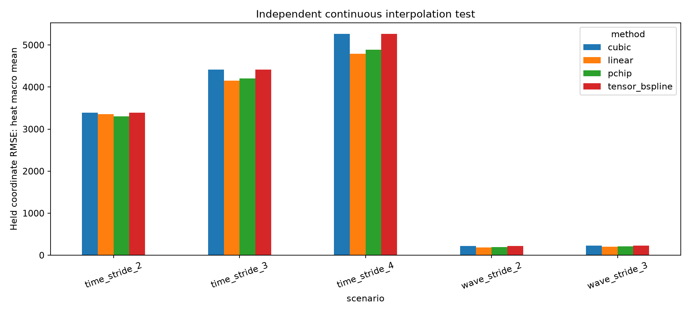

图5-3　连续降采样重构方法对照。

双线性形式还具有可直接证明的性质。第一，节点代入式(5-21)可恢复对应 $D_{ij}$；在公共边界上，相邻单元均退化为同一条边的线性插值，因而整体曲面为 $C^0$ 连续。第二，$a,b\in[0,1]$ 时四个权重非负且和为1，故

$$
\min\{D_{ij},D_{i+1,j},D_{i,j+1},D_{i+1,j+1}\}
\leq\widehat F(t,\lambda)\leq
\max\{D_{ij},D_{i+1,j},D_{i,j+1},D_{i+1,j+1}\}.
\tag{5-22}
$$

由 $D\geq0$ 可得整个定义域内 $\widehat F\geq0$，且单元内部没有超出四角范围的额外过冲。曲面在单元内部为双线性多项式，跨单元边界的一阶导数可以发生跳变，其连续性要求为 $C^0$。

对每炉 $h$，最终函数记为 $\widehat F_h:\mathcal D_h\to\mathbb R_{\geq0}$，其中 $\mathcal D_h=[0,T_h]\times[\lambda_{h,1},\lambda_{h,2047}]$，各炉边界由表5-1确定。保存的参数为实际时间向量、波长向量及 $D_h$；查询时定位单元并使用式(5-21)。密集网格和三维图均由同一函数计算。

## 5.6 模型检验与敏感性分析

### 5.6.1 异常识别与端到端修复效果

检验按功能区分为异常污染恢复、普通缺失补全和连续降采样重构。对各自的评分集合 $Q$，以 $\mathrm{RMSE}_Q=\sqrt{|Q|^{-1}\sum_{(i,j)\in Q}(\widehat Y_{ij}-Y^{ref}_{ij})^2}$ 衡量绝对误差；NRMSE用评分参考记录95%–5%分位差归一化，分母下限为1 count。污染恢复分别取注入集、其补集和全部节点作为评分集合；缺失与连续检验取留出且通过质量筛选的节点。异常污染实验使用新的开发、确认片段，覆盖十炉及蓝端、中段、红端三个波长区域；片段为 $32\times128$，开发与确认采用不同原始位置及随机种子。在参考记录上分别注入孤立增量尖峰和比例突降，强度取0.3、0.7，污染密度0.5%。各策略使用完全相同的污染输入，并统一采用秩4 Huber补全、观测保真、非负支撑和双线性插值。由“参考—污染—检测—掩码—补全—对照”形成端到端评价链。

对照包括保留策略、双向MAD策略、严格多条件保守策略，以及本文自适应多证据策略。开发时只比较综合评分阈值4和6，以污染误差、整体误差、未污染区域变化、峰高、积分和新增峰的组合评价选型。阈值4的开发综合损失为0.47185，阈值6为0.54871，确定阈值4后保持不变。表5-6给出共同300步上限下的确认结果。

表5-6　共同污染确认协议下的异常处理对照

|策略|Precision/%|Recall/%|F1/%|污染区RMSE|整体RMSE|未污染区RMSE|
|---|---|---|---|---|---|---|
|保留原始数据|0.00|0.00|0.00|6510.69|454.95|0.00|
|双向MAD|28.71|38.08|32.74|5381.77|433.87|161.85|
|严格多条件保守|100.00|18.08|30.63|6209.05|433.87|0.00|
|自适应多证据（阈值4）|89.31|70.52|78.81|2390.39|198.50|68.94|

检测指标由全部确认案例的TP、FP、FN汇总后计算；误差先在各炉内平均，再对十炉等权平均。自适应策略的Precision、Recall和F1分别为89.31%、70.52%和78.81%，在恢复更多污染点的同时降低双向MAD造成的非污染区域改动。污染区RMSE由6510.69降至2390.39 counts，整体RMSE由454.95降至198.50 counts；保守策略虽有较高Precision，但较低Recall使其污染区误差仍较大。

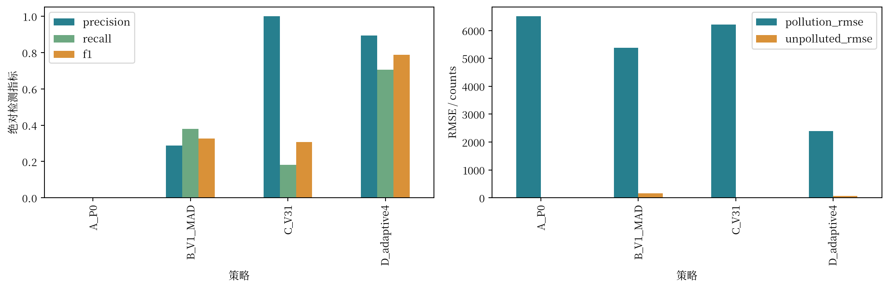

图5-4　统一协议下的端到端异常识别与修复效果。

按波长区域分组，自适应方法的污染区RMSE在蓝端为72.58 counts，中段为4972.34 counts，红端为2126.24 counts，对应双向MAD的172.17、11087.82和4885.33 counts。局部尺度与软融合使改进同时覆盖低强度和高波动区域，而不是仅针对蓝端显著尖峰。未注入的真实片段及积分变化最快帧另行用于信号保持检查，整帧变化不进入自动整行删除。

选定策略后，使用正式600/1200步检查点和数值稳定性处理，复核同一组确认案例。此时污染区RMSE为2359.80 counts，较处理前降低63.76%；整体RMSE为195.80 counts，降低56.96%；未污染区RMSE为66.68 counts。平均相对峰高误差由43.18%降至3.46%，平均相对积分误差由0.8078%降至0.1098%。这里峰值与积分均相对于注入前记录计算，反映异常污染恢复效果。

### 5.6.2 鲁棒低秩补全模型性能检验

普通缺失检验回答“在观测被隐藏而非被污染时，结构模型能否恢复其数值”。复用已完成的独立开发、测试局部协议：每炉沿三个阶段选取 $96\times192$ 片段，开发与测试位置分开；在测试片段中按1%、5%、10%随机隐藏，或连续隐藏2、4、8、16帧及4、8、16、32通道。隐藏操作先于检测、填充和拟合，模型只接收可见值。表5-7比较双向线性、平方损失秩4补全和Huber秩4补全。

表5-7　独立局部缺失检验RMSE（counts）

|遮蔽场景|双向线性|秩4平方损失|秩4 Huber|
|---|---|---|---|
|随机1%|1694.15±642.44|631.59±284.37|641.50±325.80|
|随机5%|1728.93±629.76|710.22±270.12|716.86±291.45|
|随机10%|1776.87±650.13|706.82±324.49|712.25±360.43|
|连续2帧|3333.58±2551.29|3330.57±2551.28|3330.77±2551.26|
|连续4帧|3858.21±1486.07|3855.30±1485.43|3855.39±1485.47|
|连续8帧|5428.56±2151.75|5427.51±2151.49|5427.54±2151.48|
|连续16帧|4756.06±1595.28|4755.28±1595.31|4755.28±1595.31|
|连续4通道|173.83±54.90|162.59±58.50|162.88±58.59|
|连续8通道|211.27±76.94|201.29±78.49|201.19±78.16|
|连续16通道|184.89±55.10|176.97±57.47|177.25±57.62|
|连续32通道|199.33±69.86|190.13±70.77|190.28±70.76|

表中为炉次级平均RMSE±炉间标准差，参考位置筛选为有限且 $0<Y<64000$，该质量筛选只用于评分。5%随机缺失时，Huber低秩RMSE较双向线性降低58.54%；连续8通道缺失时降低约4.77%。低秩方法在随机散点缺失上的优势尤其明显，因为未遮蔽的时间与波长信息仍能约束共同成分。整段时间缺失时，区间内整行均不可见，其恢复更多依赖缺口两侧的过程变化，表中误差与双向线性接近。

全波长矩阵的同一遮蔽种子配对核验显示：5%随机缺失时，双向线性与Huber低秩RMSE分别为2065.7和274.58 counts；连续4帧缺失时分别为5931.1和5927.0 counts；连续8通道缺失时分别为3303.2和172.29 counts。完整波长域提供了更多共同结构信息，进一步体现低秩方法在随机及波长缺失中的作用。这组全矩阵数值与表5-7的局部片段数值分别解释，不合并计算改善率。

既有人工截顶检验以未饱和记录为参考，采用65%、80%、90%分位截顶阈值和两种区域规模。遮蔽补全、单侧软惩罚、固定秩显式下界及核范数下界模型的炉次宏平均RMSE分别为2393.97、1897.59（软惩罚系数0.5）、1840.39和1413.73 counts；核范数下界模型较遮蔽补全降低约40.95%。这为条件性估计采用式(5-16)提供了直接恢复证据，真实顶码节点则另以约束满足情况评价。

观测保真后的中间矩阵可写为 $D^{fid}=\mathcal P_{\Omega_o}Y+\mathcal P_{\Omega_o^c}(UL)$，因此对同一潜变量及同一修复集合，有 $\mathcal P_{\mathcal A}D^{fid}=\mathcal P_{\mathcal A}(UL)$。在后续局部支撑和稳定性处理也保持一致时，是否复制保留观测不影响修复位置的预测。保真检验与预测精度分别统计，可以清晰识别低秩估计和节点保留各自的作用。Huber与平方损失在部分纯缺失场景中误差接近，最终采用Huber主要结合异常污染场景的有界影响需求。

### 5.6.3 连续插值与降采样重构验证

连续检验先按时间间隔1.0、1.5、2.0 s保留节点，或沿波长每隔2、3通道取样，再仅对保留节点完成预处理和填充。所有候选在同一可见网格上构造连续函数，并在留出观测的真实时间、波长坐标处调用查询接口。留出数值不参与模型构造及参数选择，评价对象因而是坐标间连续重构，而不是原网格复制。

表5-5已给出各方法RMSE。以1.5 s时间降采样为例，双线性、PCHIP、三次样条的光谱角分别约为2.29°、2.36°、4.11°；波长隔2点检验中分别为1.92°、1.95°、2.08°。峰位、峰高及积分均在相应留出且通过参考质量筛选的通道上计算。该波长检验的平均峰位误差分别为5.79、5.75、5.96 nm，相对峰高误差分别为2.00%、1.89%、1.76%，相对积分误差均约0.38%–0.39%。这些指标说明，局部峰值指标与整体误差存在取舍，双线性在整体误差及单元支撑方面具有综合优势。

上述缺失与连续检验来自既有独立局部协议，本节异常对比来自新的区域确认协议；两者均按各自的开发边界确定参数。十炉原始数据已用于整体研究，因此新区域确认体现相同炉次内部的推广能力。不同场景的重复遮蔽作为同炉重复测量，统计时先炉内汇总，再报告炉次级平均及离散程度。例如1.0 s双线性时间重构RMSE为3352.53±1243.46 counts，波长隔2点为188.77±62.64 counts。

### 5.6.4 参数敏感性及数值稳定性分析

评分阈值由4升至6时，确认Precision由89.31%升至96.05%，Recall由70.52%降至51.73%，F1降至67.24%，污染区RMSE由2390.39升至3440.22 counts。较高阈值减少非污染区域改动，但同时保留更多可修复污染。这一精度取舍与开发阶段阈值4的选型相一致。持续性与局部连通范围共同约束修复对象，宏观工艺变化继续采用诊断保留策略。

秩4的选择同时得到奇异值能量与缺失实验支持。Huber尺度固定为0.003，使大残差梯度饱和于该尺度，局部尺度下限则只用于检测得分归一化。两类尺度分别控制“哪些点需要修复”和“剩余可见偏离对背景估计的影响”，在数学上具有不同作用。既有时间正则与大容量样条对照保留为方法比较证据，正式模型采用与当前异常修复任务相匹配的固定配置。

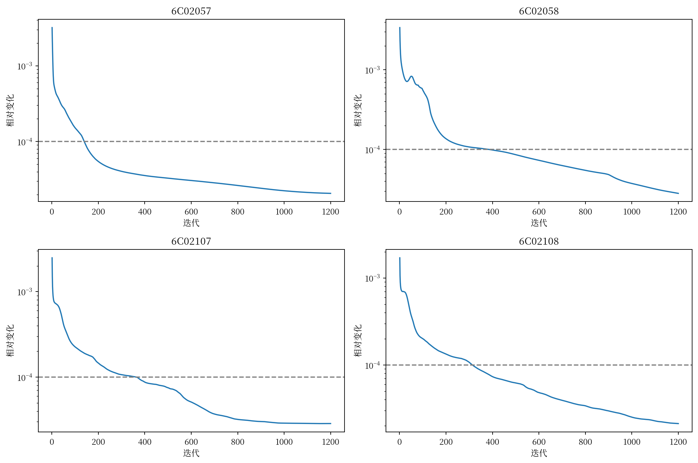

图5-5　最终低秩求解的目标函数与迭代变化。

表5-8　四炉保存迭代的目标函数与最终变化率

|炉次|Φ₃₀₀|Φ₆₀₀|Φ₁₂₀₀|δ₁₂₀₀|耗时/s|
|---|---|---|---|---|---|
|6C02057|7.094764|7.060197|7.024439|2.070e-05|75.6|
|6C02058|11.720214|11.470231|11.326857|2.803e-05|152.6|
|6C02107|9.174944|8.883694|8.790773|2.861e-05|154.4|
|6C02108|8.767298|8.525923|8.431005|2.122e-05|130.3|

表5-8对应同一次原网格计算中的三个迭代检查点，目标值使用式(5-10)的归一化强度口径。

全部十炉原网格低秩计算在1200步检查点满足相对变化率 $10^{-4}$ 的条件；四炉重点对象6C02057、6C02058、6C02107、6C02108均保留目标函数和变化率曲线。节点保真误差为0，原网格及密集查询网格负值数均为0，14,805个条件性截顶估计的下界违反数为0。数值稳定性同时检查潜变量迭代和正式修复节点，二者共同确定固定预算内的输出。

本模型适用于具有局部连续性和共同光谱背景的离线重构。模型评价集中于以下范围：整段时间缺失的改善有限，弱污染与持续谱线的区分仍有误差；正式流程的人工确认中出现17个新增峰，实际修复中465点采用可见数据双向线性回退，104个条件性饱和分块中1块保留有限迭代近似标记。现有验证基于十炉内部新区域，真实超量程峰高及上界仍由截顶观测所限制。这些质量信息随结果保存。

## 5.7 十炉次最终求解结果

采用上述检测、修复和连续重构模型，对十炉原始记录逐点处理，共实际修复1043点，占27,816,683个记录的0.00375%。其中797点向下修复、246点向上修复，修复方向由低秩估计及局部支撑共同确定。各炉分布见表5-9；所有修复集合中的节点均产生实际数值变化，集合外记录按原值保留。

表5-9　十炉实际异常修复分布

|炉次|原始记录数|实际修复点|比例/%|向上/向下|
|---|---|---|---|---|
|6B03205|3,027,513|11|0.000363|3/8|
|6B03206|2,683,617|12|0.000447|7/5|
|6B03270|2,892,411|13|0.000449|6/7|
|6B03271|2,906,740|10|0.000344|0/10|
|6C02057|1,586,425|245|0.015444|61/184|
|6C02058|2,749,121|477|0.017351|90/387|
|6C02059|3,183,085|65|0.002042|12/53|
|6C02060|2,810,531|17|0.000605|9/8|
|6C02107|2,986,573|51|0.001708|29/22|
|6C02108|2,990,667|142|0.004748|29/113|
|合计|27,816,683|1043|0.003750|246/797|

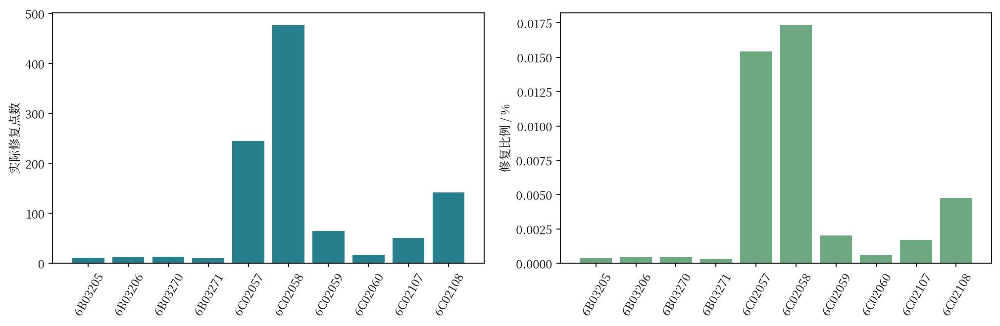

图5-6　十炉实际统计异常修复点分布。

6C02057与6C02058合计修复722点，占全部修复点的69.22%，与这些炉次高波动及高强度区域较集中的数据特征相对应。十炉保留全部1129个帧级诊断候选，实际删除整帧数为0；对整帧增强或衰减仍保持原始时间变化，仅对满足局部证据的点进行修复。

四个高证据尖峰的实际变化见表5-10和图5-7。时间邻域给出该波长的正常变化范围，波长邻域反映局部谱形，低秩背景提供共同结构参考；修复值由统一补全及支撑投影得到，并在原始记录旁保存为模型估计。

表5-10　四个高证据尖峰的实际修复

|炉次|时间/s|波长/nm|原始/counts|修复/counts|综合评分|
|---|---|---|---|---|---|
|6B03205|14.5|512.659|1767|523.87|22.15|
|6B03270|412.5|410.105|1175|429.00|6.95|
|6B03271|208.5|347.691|1275|402.00|15.26|
|6C02059|757.0|575.499|3078|965.54|32.24|

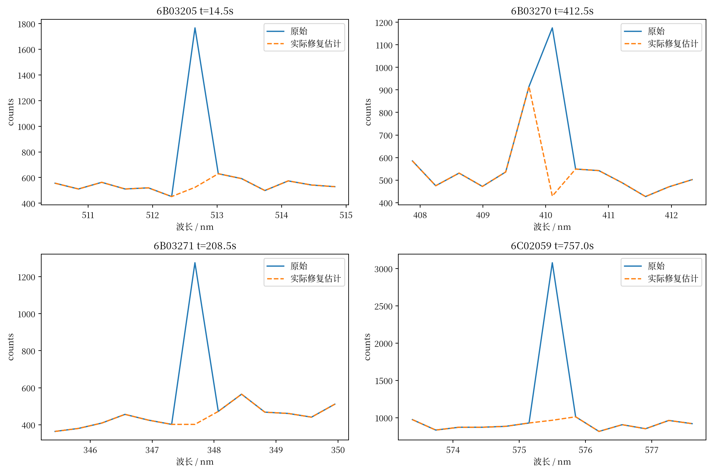

图5-7　四个高证据尖峰的修复前后对照。

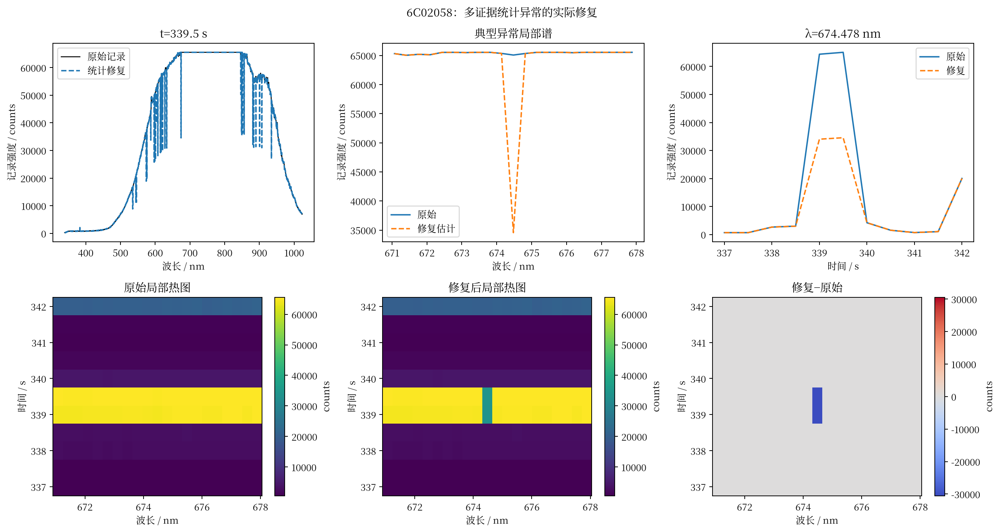

图5-8　6C02058代表性异常的曲线与局部热力图。

局部曲线与热力图显示，修复集中于少量尖峰和突降位置，前后时刻及相邻通道形成的主要光谱结构得到保留。每炉同时保存原始矩阵 $Y_h$、掩码清洗矩阵、修复矩阵 $D_h$ 以及差值 $D_h-Y_h$；差值在修复集合外严格为0。疑似截顶位置的记录尺度结果保持65535，并附带条件性估计和量程质量标记。

最终十炉连续函数统一表示为

$$
\boxed{\widehat F_h(t,\lambda)=\operatorname{Bilinear}(t_h,\lambda_h,D_h)(t,\lambda),\quad(t,\lambda)\in\mathcal D_h,\quad h\in\mathcal H,}
\tag{5-23}
$$

其中 $\mathcal H$ 为表5-1中的十炉集合，$\mathcal D_h$ 为相应实际观测定义域，具体分段表达采用式(5-21)。这些函数在定义域内可任意查询，节点和单元内部均非负。为展示时间演化与谱线分布，在每炉实际定义域内分别构造含 $2n_h-1$ 个时间点及4093个波长点的等距查询坐标，生成密集网格，绘制总览及各炉独立三维图。节点模型仍采用原始非均匀波长坐标，等距坐标仅用于曲面展示。

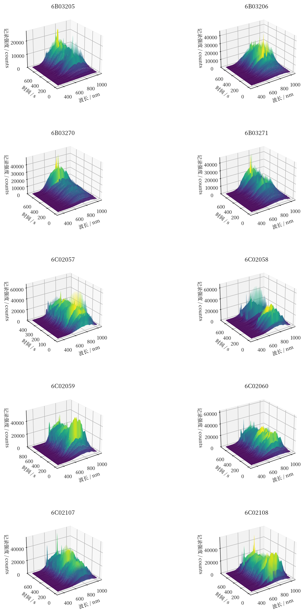

图5-9　十炉最终连续三维光谱总览。

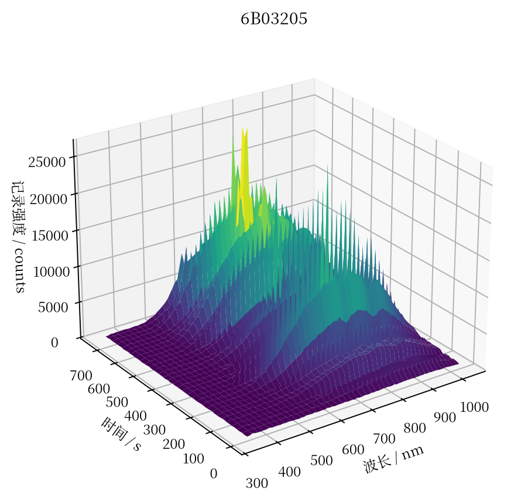

图5-10　6B03205连续三维光谱。

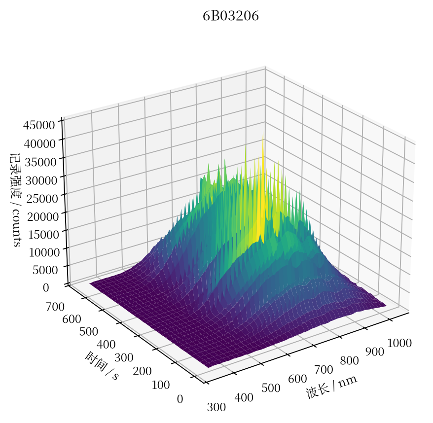

图5-11　6B03206连续三维光谱。

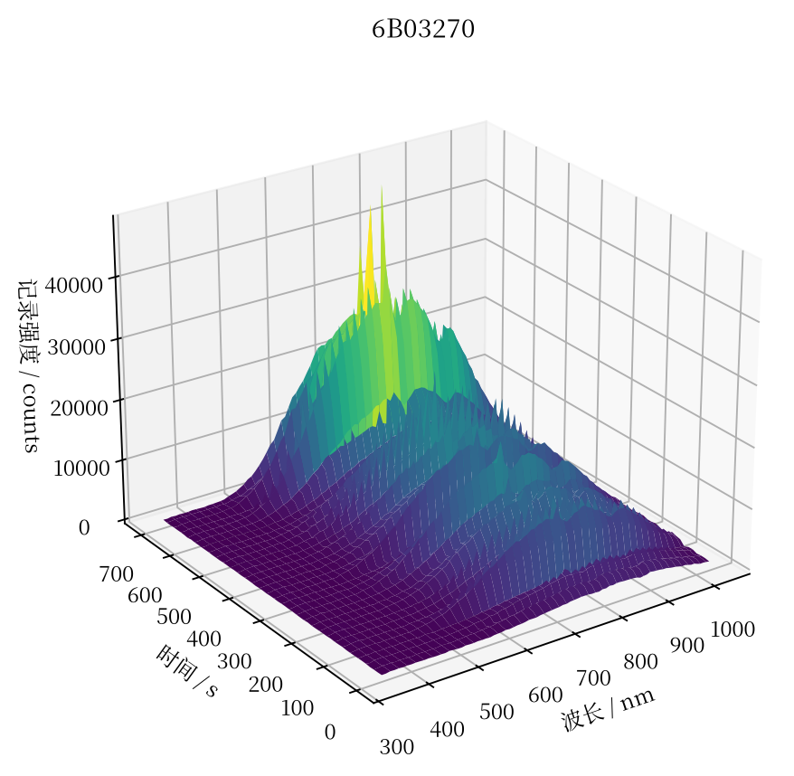

图5-12　6B03270连续三维光谱。

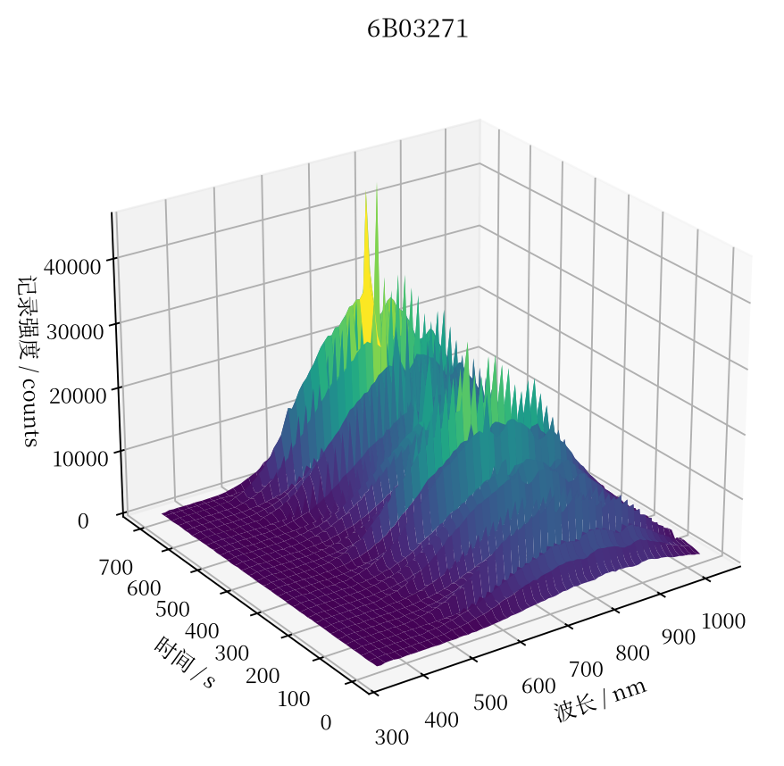

图5-13　6B03271连续三维光谱。

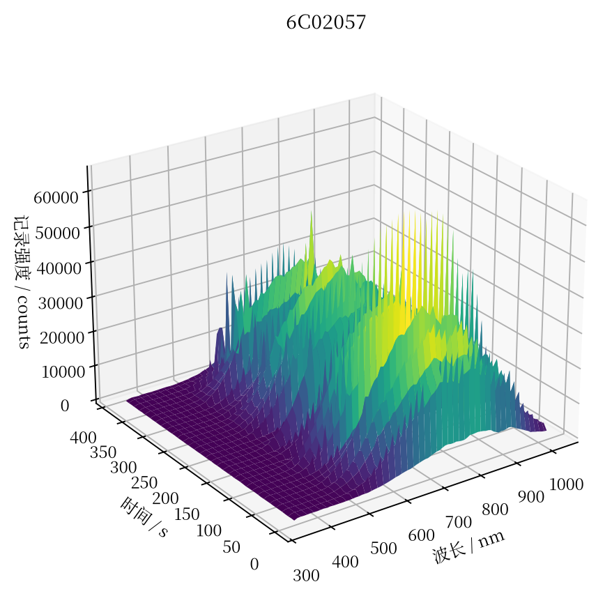

图5-14　6C02057连续三维光谱。

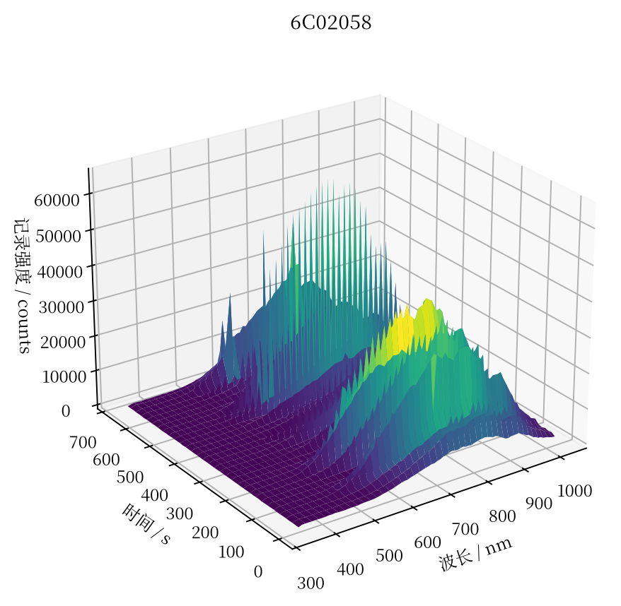

图5-15　6C02058连续三维光谱。

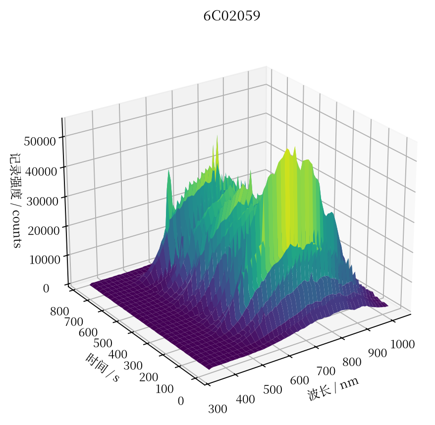

图5-16　6C02059连续三维光谱。

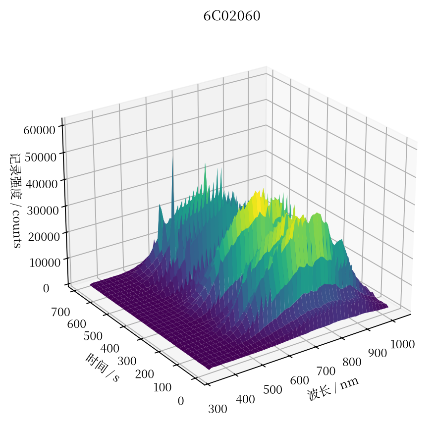

图5-17　6C02060连续三维光谱。

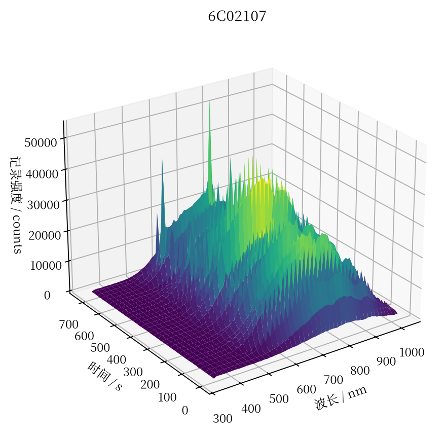

图5-18　6C02107连续三维光谱。

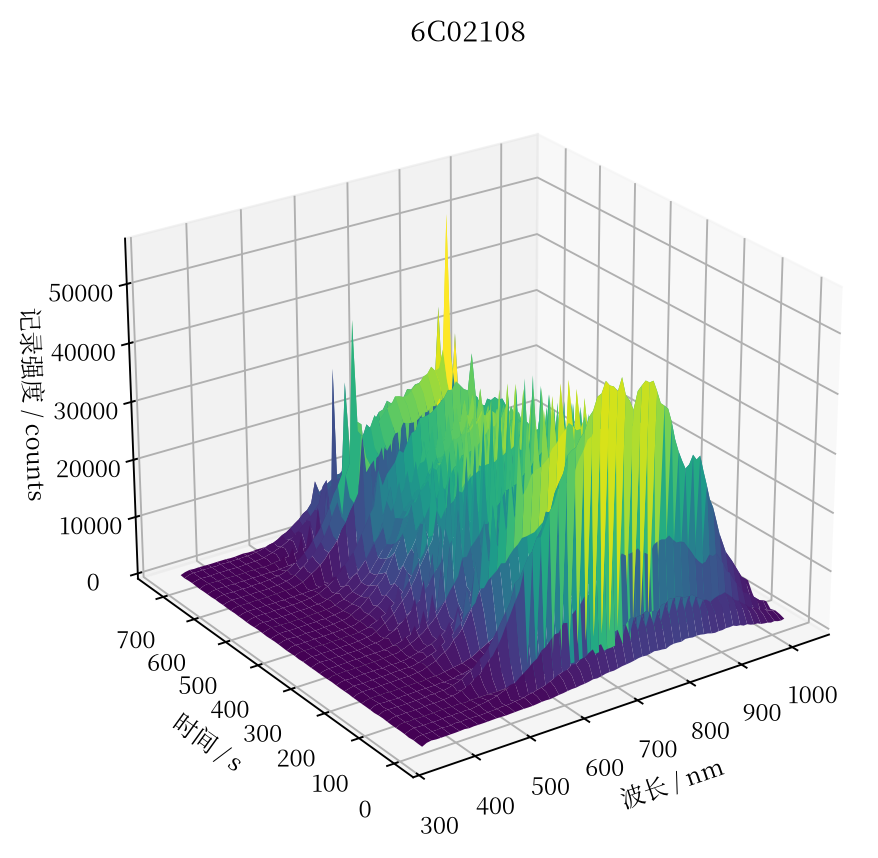

图5-19　6C02108连续三维光谱。

由此，第一问形成从原始光谱分析、分类异常识别、实际点修复到连续数学函数的完整结果：1043个局部统计异常完成修复，主要有效记录与工艺变化得到保留；十炉均获得基于实际时间和波长坐标的非负连续光谱曲面。异常识别和端到端恢复实验支持处理方案，低秩缺失实验及真实坐标降采样实验分别支持补全模块和连续表达的选择。
