# 十炉次探索性分析

| heat_id | adjacent_time_correlation | adjacent_wavelength_correlation | median_abs_time_derivative | median_abs_wavelength_derivative |
| --- | --- | --- | --- | --- |
| 6B03205 | 0.8538048541998288 | 0.9995292922659413 | 846.0 | 162.01117318432998 |
| 6B03206 | 0.8538763085445173 | 0.9996478236239754 | 1428.0 | 205.38720538718778 |
| 6B03270 | 0.8447959900468165 | 0.9996326519398915 | 1320.0 | 190.2173913043504 |
| 6B03271 | 0.8506136065655663 | 0.9996065796132091 | 1338.0 | 194.6107784430788 |
| 6C02057 | 0.7482386998672403 | 0.9997055310605271 | 3164.0 | 261.32404181191873 |
| 6C02058 | 0.5944952391145996 | 0.9997990295950898 | 2250.0 | 194.07008086254368 |
| 6C02059 | 0.8559707732370492 | 0.9996770800315861 | 2218.0 | 252.14899713463697 |
| 6C02060 | 0.817328930067578 | 0.9996833369409188 | 2572.0 | 261.00628930818954 |
| 6C02107 | 0.7658151013521007 | 0.9996302624909262 | 2784.0 | 249.99999999995853 |
| 6C02108 | 0.8391366184885595 | 0.999652921939351 | 2648.0 | 265.9932659932432 |

相邻波长相关极强，时间相关较弱，特别6C02058约0.59；因此不能把整条快速变化的帧直接删除，时间强平滑必须经验证。两方向变化率单位不同，不能直接比较数值大小。

每炉raw下保存真实轴热力图、早中晚光谱、400/589/770/950nm最近实际通道时间曲线、光强分布与最大值波长曲线；有截顶炉次另存饱和局部图。曲线显示多种宽带与局部峰结构，单一固定裁剪会损失信息。

## 6B03205

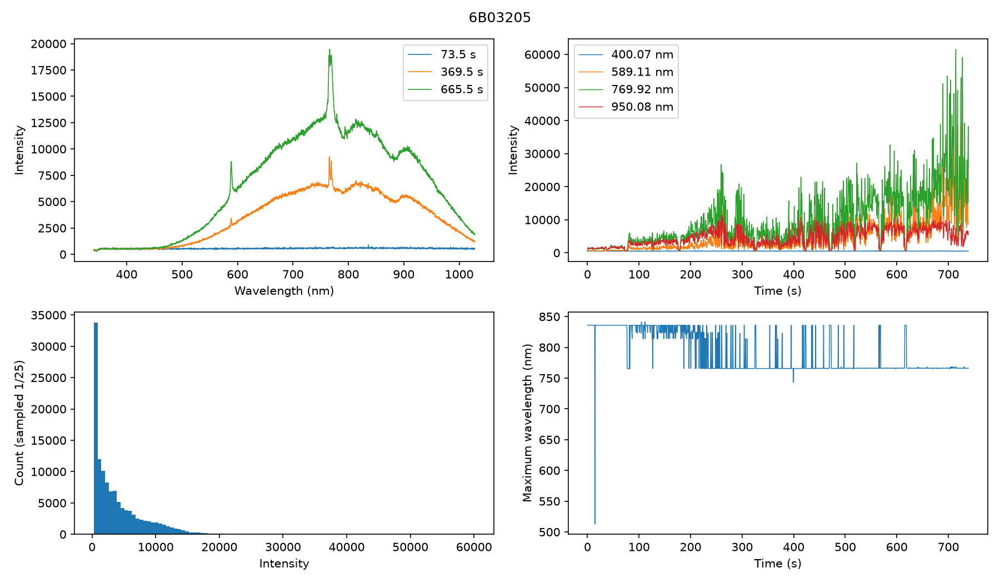

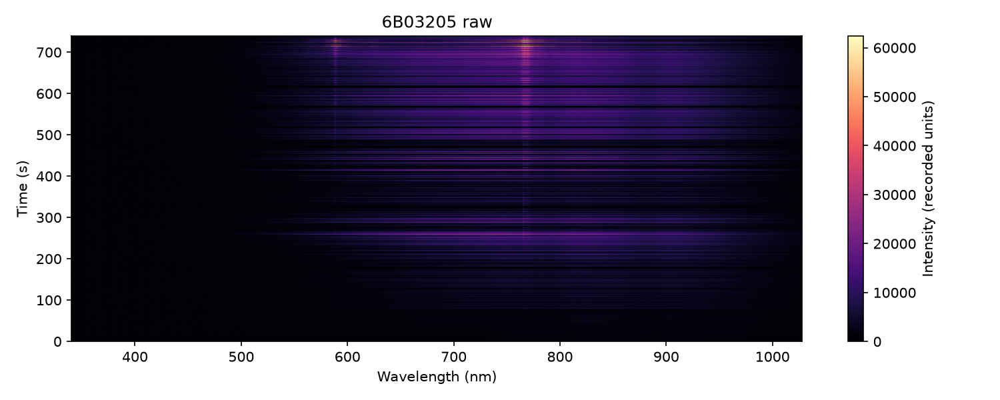

## 6B03206

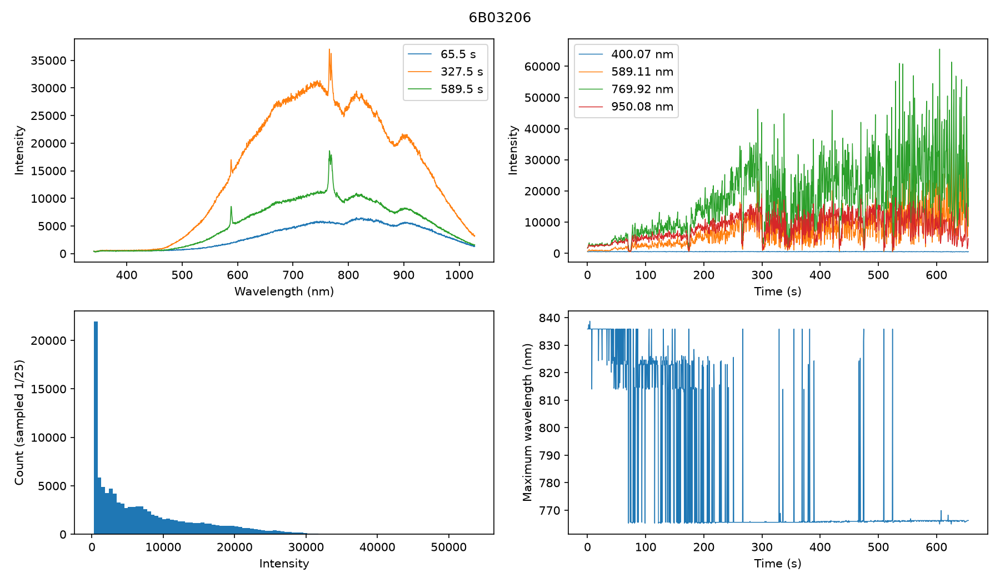

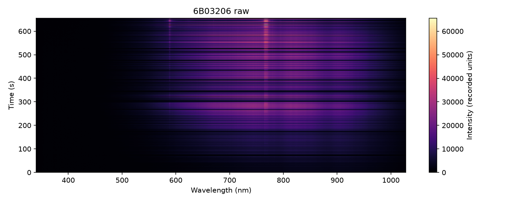

## 6B03270

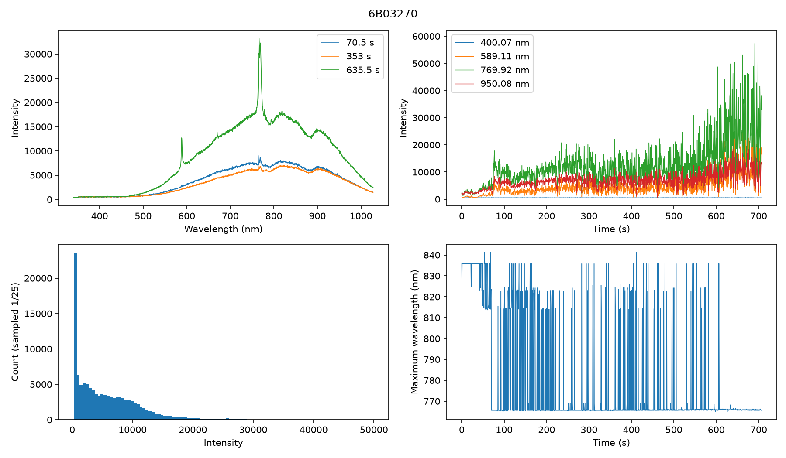

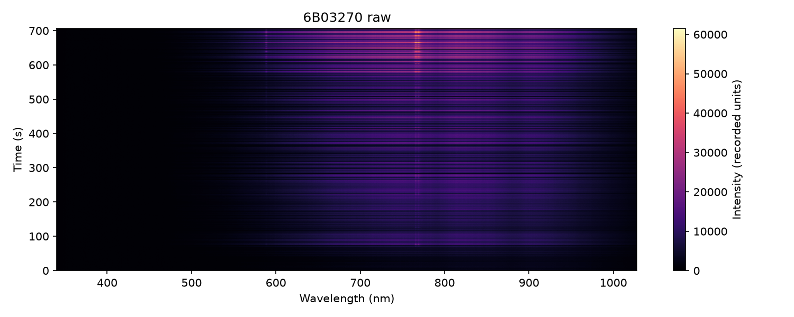

## 6B03271

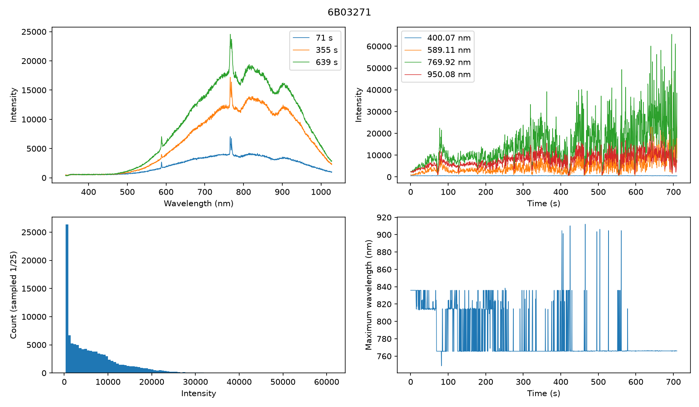

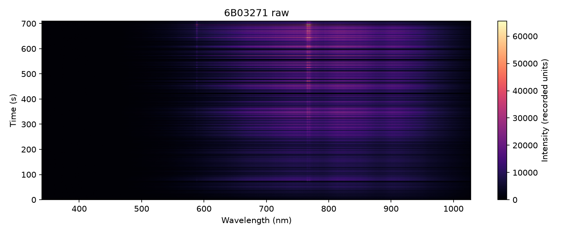

## 6C02057

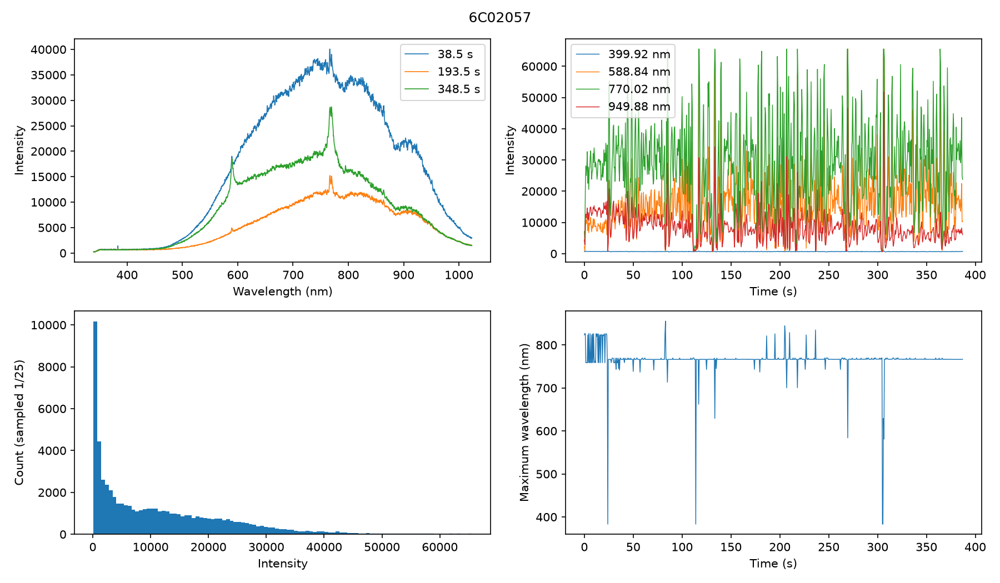

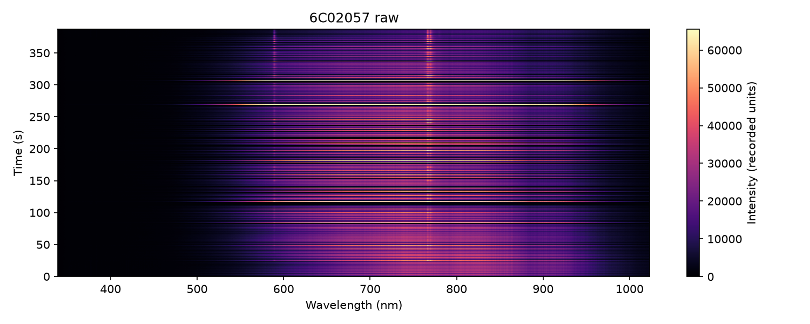

## 6C02058

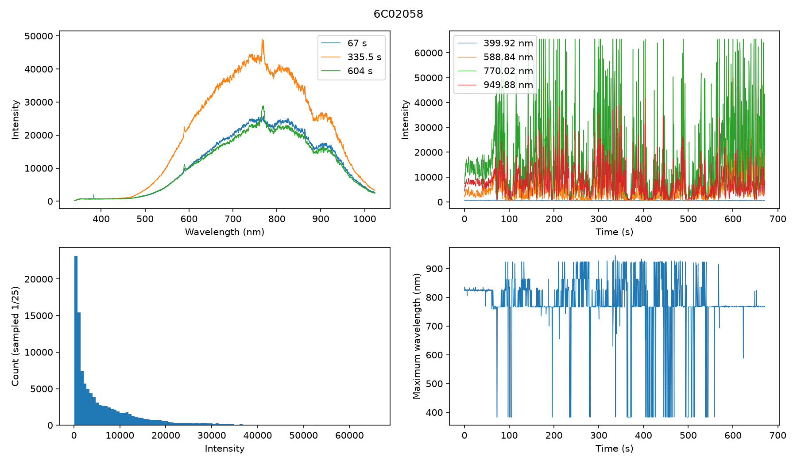

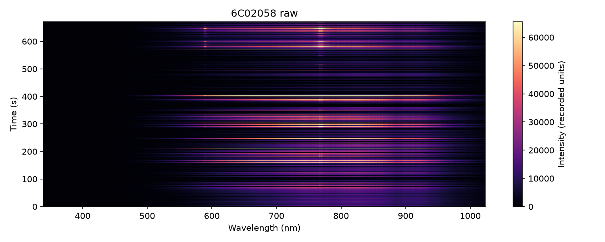

## 6C02059

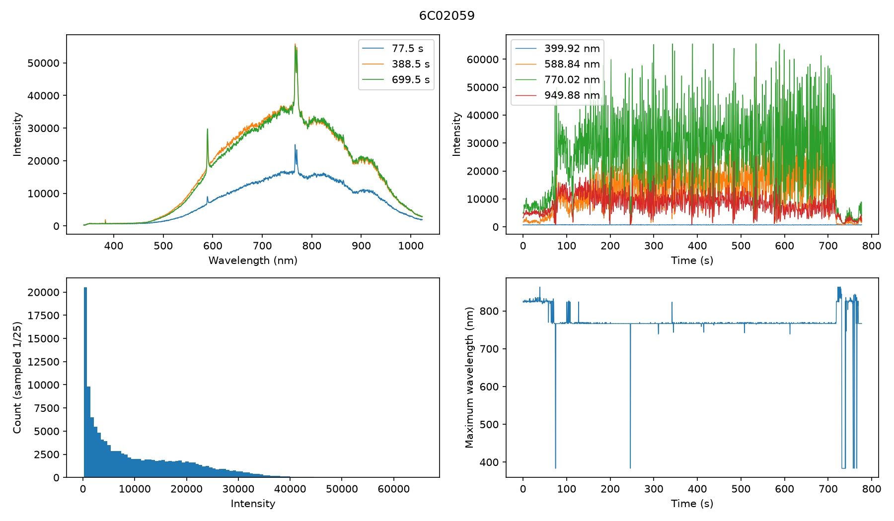

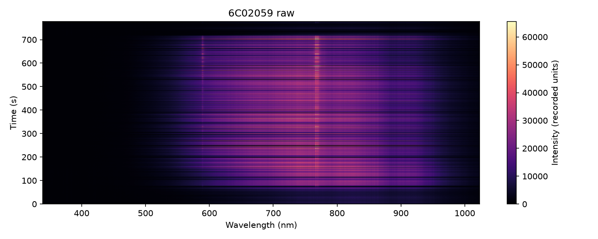

## 6C02060

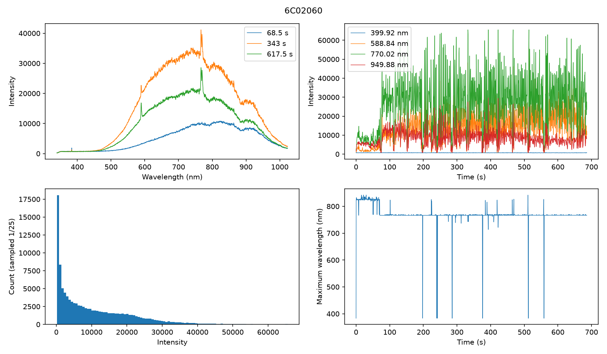

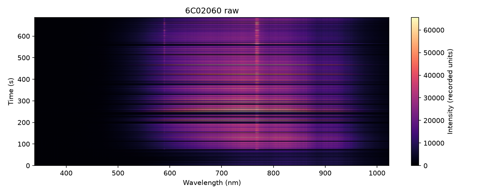

## 6C02107

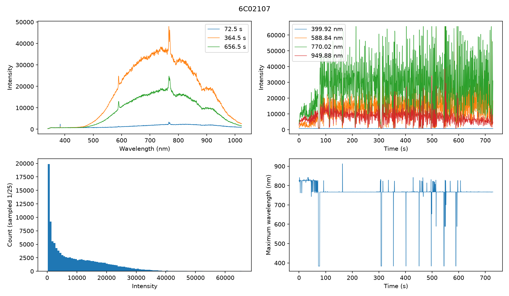

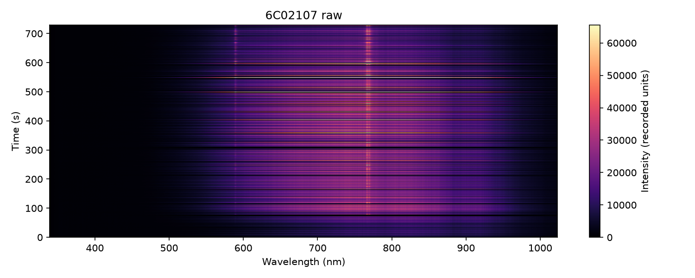

## 6C02108

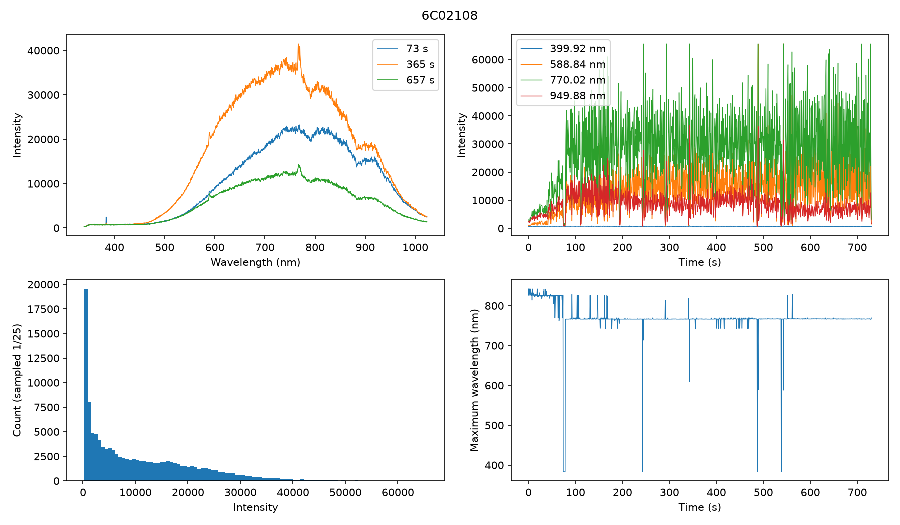

