# 问题一 V2：模型深化、独立验证与严格验收

基准分支problem1，V1提交d8817f2。全部V1代码、原始数据、结果与报告保留不变；本报告仅对应problem1/v2。数字来自本目录实际CSV，单位为原始记录强度。没有开展第二、三问，没有使用烟气/氧气预测输入，没有撰写英文论文。

## 1 问题重述与问题分析

目标是识别火焰光谱中的仪器异常，利用时间和波长双向相关性补全缺失/异常区域，并建立可在实际坐标查询的连续曲面。必须分别回答“原始离散网格上能补回多少”和“留出的真实采样坐标能预测多少”，不能把观察点的硬复制当成预测准确率。

V1审计发现：检测器开发/测试共用原始片段；检测参数选择未先隔离外层区域；参考质量与随机遮蔽几何有关；150个V1分数是网格补全而不是连续插值。详见[完整审计](00_V1模型审计.md)。V2先按几何位置隐藏观测，再计算检测、噪声尺度与时间权重。清洗、补全、插值全程不可访问隐藏值。

本轮不以算法堆叠制造贡献。实际新增内容是可审核的可见性协议、带梯度核对的条件性饱和优化、有效观测保持与独立预测分离、具有失败证据的模型对比。尚未完成近邻文献全景比较，不能据此声称这些组合具有绝对原创性。

## 2 模型假设与符号说明

Y∈R^{n×m}是单炉次原始强度，t_i、λ_j均取附件真实数值。M是训练掩码，Q是只在评分时生成的参考位置，Ω_sat是可见65535编码位置；U=65535，X=Y/U。L为潜在低秩矩阵，S为稀疏偏离，r为秩上界，η为稀疏罚，γ为单侧下界罚，β为二阶时间罚，a_i为可见观测得到并冻结的时间权重。

假设包括局部时空相关和近似低秩；不假设所有窄峰都是异常，不假设整帧亮度跳变就是仪器错误。16位ADC及重复顶码支持条件性上截顶解释，但没有仪器标定/原始曝光记录可证明全部顶码的确切机制。真实饱和区域仅提供条件性下界，峰高上界不可辨识。

## 3 光谱数据审计及统计特征分析

沿用已核实的十炉13589条时间记录、2047个光谱通道。新附件1 SHA256为8c73aaefadb9c8d8c3f83b193d9b4583dcfdfb239446c69b7eacd4120820783c。前四炉波长340.535–1027.963nm，后六炉339.390–1023.303nm；不统一成虚构等间距坐标。时间间隔0.5s；无NaN/Inf、零值、负值或重复整谱。8炉共14805个65535疑似饱和点。

主协议每炉六段互不重叠的96×192原始片段，交替分配开发/测试，分别覆盖早、中、晚和三个波长区域。开发种子137、271；测试种子811、1297。共30个开发片段与30个独立原始测试片段。时间与波长区域在此设计中部分混杂，不能据此单独解释“阶段效应”；全矩阵确认提供补充但不是新炉次外部验证。

训练随机遮蔽独立于强度。测试1%、5%、10%随机缺失，连续时间2/4/8/16点，连续波长4/8/16/32通道。每次完整隐藏几何带，包括不适合评分的值。参考筛选0<Y<64000只影响评分，同时保存0<Y<65535的更宽条件误差及保留比例。它仍偏向未饱和参考区域，原观测也含噪声和自然异常，并非人工无噪声真值。

全部局部比较先在每炉内平均阶段和种子，再报告十炉宏平均与炉间标准差；重复遮蔽不是独立炉次。任何置信解释均受十炉固定样本限制。

## 4 光谱低秩性质的数学验证

以下为V1保存的真实完整矩阵奇异值能量审计，本轮只读复用。能量集中说明存在低维结构；未中心化的首分量大量反映亮度，不能直接等同于光谱形状的低维性，故同时列中心化结果。高能量覆盖不保证窄峰、异常和整段缺失的恢复。
| heat_id | raw_rank1_energy | raw_rank4_energy | raw_rank12_energy | centered_rank4_energy | centered_rank12_energy |
|---|---|---|---|---|---|
| 6B03205 | 0.98224 | 0.99924 | 0.99977 | 0.99863 | 0.99932 |
| 6B03206 | 0.99171 | 0.99956 | 0.99976 | 0.99839 | 0.99908 |
| 6B03270 | 0.99463 | 0.99964 | 0.99979 | 0.99845 | 0.99907 |
| 6B03271 | 0.99209 | 0.99958 | 0.99977 | 0.99812 | 0.9989 |
| 6C02057 | 0.98556 | 0.99832 | 0.99945 | 0.99335 | 0.99785 |
| 6C02058 | 0.97084 | 0.99627 | 0.99816 | 0.99302 | 0.99638 |
| 6C02059 | 0.99081 | 0.99927 | 0.99964 | 0.99742 | 0.99845 |
| 6C02060 | 0.99171 | 0.99915 | 0.99958 | 0.997 | 0.99825 |
| 6C02107 | 0.98998 | 0.9986 | 0.99944 | 0.9943 | 0.99759 |
| 6C02108 | 0.9897 | 0.99913 | 0.99964 | 0.99601 | 0.99813 |

V13在PDF p5明确指出“整列稀疏”可能同时低秩，分离不可辨识。整行完全缺失时，行潜因子没有观测约束；时间先验只能补充假设，无法知道被完全遮蔽的突变。低秩证据因此支持候选模型，不能证明所有缺失模式都可唯一恢复。

## 5 分类异常识别模型

保留双向MAD基线，新增低秩残差、连通支持、归一化光谱角、亮度与形状变化分解，以及持续通道候选。低秩残差联合双向局部证据的连通区域才可增加自动掩码；整帧和持续通道主要保留为辅助诊断，不因单一异常分数删除。持续窄线也可能是真实发射峰。两种诊断脚本的角色区分：detector.py是锁定的训练检测器；structure_diagnostics.py仅解释全炉可见结构，不修改任何验证掩码。

人工异常六类覆盖不同原始阶段/波长、两种强度、开发持续长度1/4与独立测试长度2/6，种子与原始时间片段均分离。开发选择受新增误报率≤0.005约束。下表为测试十炉宏平均，Precision/F1为相对未注入基线的增量评价；raw_FPR把原始基线检测也作为非注入点误报计入，是更保守的另一口径。不能仅报告扣除基线后的高Precision。
| method | kind | precision | recall | f1 | false_positive_rate | raw_false_positive_rate | total_deleted_fraction |
|---|---|---|---|---|---|---|---|
| MAD | column | 0.49752 | 0.032986 | 0.058779 | 4.7358e-05 | 0.0024396 | 0.0027561 |
| MAD | drop | 0.97315 | 0.48426 | 0.59771 | 1.5479e-05 | 0.0024353 | 0.0033764 |
| MAD | row | 0.21394 | 0.0029803 | 0.0058274 | 4.1951e-05 | 0.002404 | 0.0024486 |
| MAD | saturation | 0.99751 | 1 | 0.99872 | 8.225e-06 | 0.0024675 | 0.0057147 |
| MAD | short_block | 0.11667 | 0.0050926 | 0.0096168 | 6.4106e-06 | 0.0024603 | 0.0024676 |
| MAD | spike | 0.96955 | 0.48333 | 0.59419 | 1.0914e-05 | 0.0024235 | 0.0033628 |
| auxiliary | column | 0.49424 | 0.033507 | 0.059614 | 5.0158e-05 | 0.0024452 | 0.0027669 |
| auxiliary | drop | 0.97177 | 0.48426 | 0.59761 | 1.639e-05 | 0.0024371 | 0.0033782 |
| auxiliary | row | 0.21394 | 0.0029803 | 0.0058274 | 4.3892e-05 | 0.0024087 | 0.0024532 |
| auxiliary | saturation | 0.99751 | 1 | 0.99872 | 8.225e-06 | 0.0024721 | 0.0057192 |
| auxiliary | short_block | 0.11667 | 0.0050926 | 0.0096168 | 6.4106e-06 | 0.0024621 | 0.0024694 |
| auxiliary | spike | 0.96621 | 0.48333 | 0.59411 | 1.1825e-05 | 0.0024253 | 0.0033646 |

辅助检测的提升很小，整帧、整列和短块的低召回是明确失败结果。这里不通过删除大量整帧/整列追求召回，不能声称已建立可靠的全类型异常识别器。亮度变化与形状变化的全炉辅助统计如下；候选不等同于仪器错误标签。
| heat_id | brightness_dominant_frames | shape_change_frames | persistent_channel_candidates | candidate_auto_deleted |
|---|---|---|---|---|
| 6B03205 | 31 | 330 | 0 | 0 |
| 6B03206 | 40 | 276 | 7 | 0 |
| 6B03270 | 72 | 196 | 3 | 0 |
| 6B03271 | 51 | 248 | 7 | 0 |
| 6C02057 | 48 | 220 | 16 | 0 |
| 6C02058 | 43 | 720 | 2 | 0 |
| 6C02059 | 110 | 236 | 12 | 0 |
| 6C02060 | 119 | 245 | 12 | 0 |
| 6C02107 | 90 | 449 | 17 | 0 |
| 6C02108 | 96 | 312 | 15 | 0 |

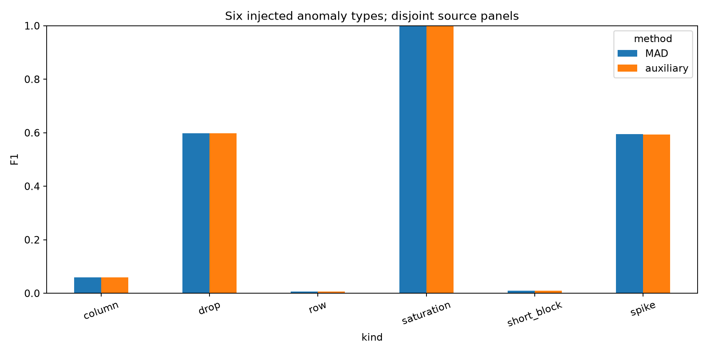

## 6 饱和感知低秩光谱补全模型

完整目标、消元、梯度、回溯、ADMM子问题与参数单位见[数学推导](01_数学推导.md)。V13原始PCP为核范数+ℓ1等式模型，V14 SOFT-IMPUTE为核范数正则；本轮B系列是V1固定秩平方/鲁棒损失的任务改造，不能继承凸PCP的全局恢复结论。

单侧软罚为γ/2 Σ_{Ωsat}[1−L_ij]_+²。B5额外β||A^{1/2}D²_t L||²，a_i仅由可见相邻行变化率确定。未看到的快速变化不能参与估权。

显式固定秩分裂采用不精确非凸ADMM，返回的L必须检查下界违反；“相对残差小”不等于每个点严格满足。另实现带核范数的凸可行替代，X子问题投影下界、Z子问题SVT；每轮X都是优化变量，不是在绘图前改数值；最终输出另在有效点作观测保真投影，饱和点分数不含这些复制位置，输出网格也不再保证小核范数。其有限迭代仍需原始/对偶残差验证。

人工截顶使用已知未饱和真实数据，三个阈值分位数0.65/0.8/0.9，两种区域4×16、12×48，两种测试种子，三阶段十炉，共1800次方法比较；其中n=0的条件保留为空、不伪造零误差。下表先炉内平均再列炉间离散程度。
| ('method', '') | ('rmse', 'mean') | ('rmse', 'std') | ('lower_bound_violation', 'mean') | ('lower_bound_violation', 'std') | ('shortfall', 'mean') | ('shortfall', 'std') | ('converged', 'mean') | ('converged', 'std') |
|---|---|---|---|---|---|---|---|---|
| convex_nuclear_bound | 1413.7 | 1087.7 | 0 | 0 | 0 | 0 | 1 | 0 |
| hard_ADMM | 1840.4 | 1268.5 | 0.12117 | 0.032935 | 0.2569 | 0.41614 | 1 | 0 |
| mask | 2394 | 1256.7 | 0.56146 | 0.1348 | 525.96 | 232.84 | 1 | 0 |
| soft_0.5 | 1897.6 | 1253.2 | 0.40484 | 0.11774 | 13.524 | 5.1615 | 1 | 0 |
| soft_4 | 1940.3 | 1286.1 | 0.36721 | 0.10202 | 6.3426 | 2.4641 | 1 | 0 |

人工截顶各条件以cap归一化为1，因此固定η对应的强度阈值为η×cap；跨阈值比较还包含这一尺度变化，不能把所有差异归因于截顶阈值本身。凸对照也将鲁棒固定秩损失改成平方项与核范数，τ=0.01、ρ=1固定，因而其优于其他方法不能单独归因于“硬约束”。

凸核范数下界方案的优势是在本轮人工截顶条件下得到的，不能直接证明实际65535以上的峰高已知。它是预设对照，没有根据测试结果反向替换锁定最终模型。

真实饱和8炉的下界违反统计如下，数值不是对未知真实峰高的误差。三个重点炉次还对饱和最密集的局部窗口运行凸约束，明确报告局部覆盖率，不能冒充全炉凸重构。
| heat_id | method | count | lower_violation | shortfall | converged |
|---|---|---|---|---|---|
| 6C02057 | mask | 4168 | 0.73057 | 9547.5 | True |
| 6C02057 | soft_0.5 | 4168 | 0.125 | 29.101 | True |
| 6C02057 | soft_4 | 4168 | 0.10029 | 7.1775 | True |
| 6C02057 | hard_ADMM | 4168 | 0.0088772 | 0.16774 | True |
| 6C02058 | mask | 5805 | 0.95866 | 12061 | False |
| 6C02058 | soft_0.5 | 5805 | 0.02963 | 15.694 | True |
| 6C02058 | soft_4 | 5805 | 0.057364 | 10.218 | True |
| 6C02058 | hard_ADMM | 5805 | 0.0024117 | 0.016499 | True |
| 6C02107 | mask | 2110 | 0.29147 | 2709.3 | False |
| 6C02107 | soft_0.5 | 2110 | 0.0099526 | 32.337 | True |
| 6C02107 | soft_4 | 2110 | 0.062085 | 25.327 | True |
| 6C02107 | hard_ADMM | 2110 | 0.0014218 | 0.0097548 | True |
| heat_id | method | row_start | column_start | local_saturation_count | whole_heat_sat_count | local_coverage | lower_violation | seconds | converged | actual_error_identifiable |
|---|---|---|---|---|---|---|---|---|---|---|
| 6C02057 | convex_nuclear_bound_local | 565 | 708 | 277 | 4168 | 0.066459 | 0 | 0.21409 | True | False |
| 6C02058 | convex_nuclear_bound_local | 615 | 1113 | 969 | 5805 | 0.16693 | 0 | 0.13005 | True | False |
| 6C02107 | convex_nuclear_bound_local | 1049 | 1026 | 448 | 2110 | 0.21232 | 0 | 0.16314 | True | False |

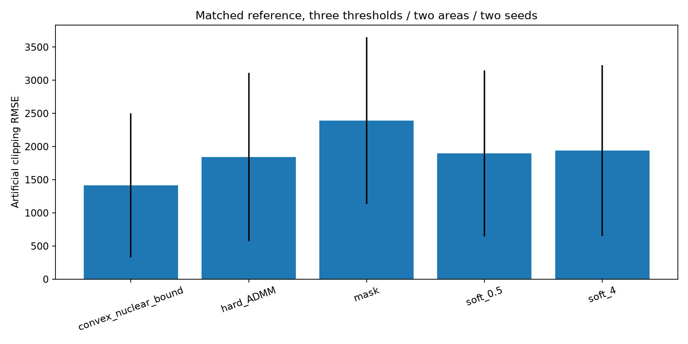

## 7 连续光谱曲面重构方法

连续验证只保留时间间隔1.0/1.5/2.0s或每2/3个真实波长采样，再在被留出的真实坐标evaluate。隐藏值不参与清洗、补全或参数选择。方法比较共享同一清洗网格，分别为线性、三次样条、PCHIP和零平滑张量积插值B样条。三次样条与后者数学上是同一函数的不同基表示，数值相等合理，不能当作两个独立方法的成功证据。

PCHIP基于邻接割线的加权调和斜率，有一维保形/C1依据；本题二维先时间后波长的组合需要独立评价，不提升为全局C2保证。线性插值在每个原始矩形单元内为双线性组合，连续但跨单元导数可不连续。

插值方法的开发宏NRMSE如下，最终锁定 linear。
| index | development_macro_nrmse |
|---|---|
| cubic | 0.24366 |
| linear | 0.22718 |
| pchip | 0.23169 |
| tensor_bspline | 0.24366 |

下表为独立局部片段测试RMSE，报告十炉宏平均和炉间标准差；MAE、SAM、峰位、峰高、积分、负值、角点界过冲完整见interpolation_independent_macro.csv。时间留行时是全可用波长谱形，波长留带时仅为该带内谱形；随机稀疏Q上的峰指标也仅对应评分子集，不能作为全谱主峰误差。
| scenario | method | mean | std |
|---|---|---|---|
| time_stride_2 | cubic | 3388.3 | 1273.2 |
| time_stride_2 | linear | 3352.5 | 1243.5 |
| time_stride_2 | pchip | 3299.8 | 1210 |
| time_stride_2 | tensor_bspline | 3388.3 | 1273.2 |
| time_stride_3 | cubic | 4418.7 | 1790.8 |
| time_stride_3 | linear | 4152.6 | 1764 |
| time_stride_3 | pchip | 4207.6 | 1736.7 |
| time_stride_3 | tensor_bspline | 4418.7 | 1790.8 |
| time_stride_4 | cubic | 5266.4 | 2140.4 |
| time_stride_4 | linear | 4791 | 1987.7 |
| time_stride_4 | pchip | 4890.5 | 2007.2 |
| time_stride_4 | tensor_bspline | 5266.4 | 2140.4 |
| wave_stride_2 | cubic | 216.23 | 78.026 |
| wave_stride_2 | linear | 188.77 | 62.644 |
| wave_stride_2 | pchip | 192.12 | 62.797 |
| wave_stride_2 | tensor_bspline | 216.23 | 78.026 |
| wave_stride_3 | cubic | 231.4 | 74.094 |
| wave_stride_3 | linear | 206.65 | 60.985 |
| wave_stride_3 | pchip | 214.64 | 65.042 |
| wave_stride_3 | tensor_bspline | 231.4 | 74.094 |

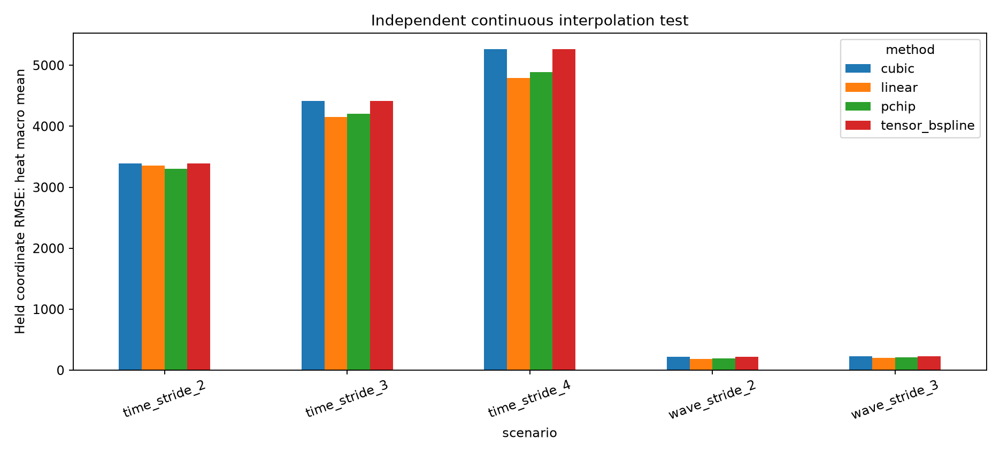

## 8 参数估计与数值求解

B候选秩4/8，η=0.003/0.01，γ=0.5/4，β=0.03/0.3；先按开发数据锁定。C先做受控诊断，再在3种容量×3种Huber尺度的九配置中按相同开发片段、场景、种子和掩码选择。容量对照先保持alpha×nm/(KtKw)这个系数差分罚的权重，避免V1显式乘数混杂；但节点间距改变还会改变其对应的连续导数强度，因此不构成严格的连续粗糙度不变对照。另补做按(kt−3)^3/(kw−3)及对称空间因子的近似积分导数尺度修正，只用于开发解释，非精确导数Gram积分，也不修改锁定模型。C的PCG/IRLS是否停止与预测误差分别记录。

开发选择表：
| index | development_macro_nrmse |
|---|---|
| B0 | 0.24419 |
| B1 | 0.22257 |
| B2 | 0.22232 |
| B3 | 0.22232 |
| B4 | 0.22267 |
| B5 | 0.25375 |
| C | 0.35714 |

开发评分锁定的离散候选为 B2，参数 {"rank": 4, "eta": 0.003, "gamma": 0.5, "beta": 0.03}。B2无饱和/时间项，故JSON中的gamma/beta为共用候选字典的未启用字段，不代表最终模型使用了它们。B2/B3缺失网格分数相同，按预设较低复杂度打破并列，选择B2，不因后来确认性结果改选。

C受控开发诊断（只对应随机5%，各对照共享MAD阈值9的训练掩码；不同于主比较选出的阈值6辅助掩码，不能直接与主表比较，也不能概括全部场景）：
| setting | mean | std |
|---|---|---|
| base | 4074 | 1870.8 |
| capacity_48_96 | 3596.8 | 1545.6 |
| capacity_96_192 | 2884.1 | 1137.2 |
| capacity_full_quadratic | 18707 | 8149.2 |
| huber_delta_20 | 3895.6 | 1812.8 |
| quadratic | 3688.4 | 1676.5 |
| time_penalty_0.03 | 4224.9 | 1808.7 |
| time_penalty_zero | 3970.2 | 1814.5 |

| kt | kw | mean | std |
|---|---|---|---|
| 24 | 48 | 4074 | 1870.8 |
| 48 | 96 | 3898.7 | 1765.9 |
| 96 | 192 | 3828 | 1717 |

增大容量在系数罚固定对照下改善误差；导数尺度修正后的结果需与上表一起看，不能把全部改善都归因为节点数量。减小时间罚和增大Huber尺度也有影响，三者不能用一个原因概括。全容量、极小惩罚、二次损失的组合反而恶化，说明无约束扩容可能不稳定。C整体开发和测试表现不足，不等于B样条方法本身无效。

四炉的同可见性求解器预算对照：
| heat_id | solver | iteration | relative_change | held_rmse | converged_1e4 | converged_1e5 |
|---|---|---|---|---|---|---|
| 6C02057 | V1 | 30 | 0.00036773 | 11495 | False | False |
| 6C02057 | V1 | 120 | 0.00011831 | 11495 | False | False |
| 6C02057 | V1 | 300 | 3.9133e-05 | 11494 | True | False |
| 6C02057 | V2 | 30 | 0.00036374 | 11495 | False | False |
| 6C02057 | V2 | 120 | 0.00011617 | 11495 | False | False |
| 6C02057 | V2 | 300 | 3.9055e-05 | 11494 | True | False |
| 6C02058 | V1 | 30 | 0.00059656 | 11390 | False | False |
| 6C02058 | V1 | 120 | 0.00024621 | 11364 | False | False |
| 6C02058 | V1 | 300 | 8.8185e-05 | 11333 | True | False |
| 6C02058 | V2 | 30 | 0.00057986 | 11390 | False | False |
| 6C02058 | V2 | 120 | 0.0002491 | 11364 | False | False |
| 6C02058 | V2 | 300 | 8.7003e-05 | 11332 | True | False |
| 6C02107 | V1 | 30 | 0.00032413 | 4951.2 | False | False |
| 6C02107 | V1 | 120 | 0.00016466 | 4937 | False | False |
| 6C02107 | V1 | 300 | 3.8808e-05 | 4932.4 | True | False |
| 6C02107 | V2 | 30 | 0.00032014 | 4951 | False | False |
| 6C02107 | V2 | 120 | 0.00016662 | 4937 | False | False |
| 6C02107 | V2 | 300 | 3.8474e-05 | 4932.5 | True | False |
| 6C02108 | V1 | 30 | 0.00065354 | 3996.3 | False | False |
| 6C02108 | V1 | 120 | 0.00018683 | 3997.4 | False | False |
| 6C02108 | V1 | 300 | 0.00010894 | 3994.7 | False | False |
| 6C02108 | V2 | 30 | 0.00064387 | 3996.5 | False | False |
| 6C02108 | V2 | 120 | 0.00018616 | 3997.4 | False | False |
| 6C02108 | V2 | 300 | 0.00010868 | 3994.7 | False | False |

V1的50条历史外层曲线没有观测到目标上升；全炉保存迭代的SVD种子扰动远小于实际每步变化，不能把主要未收敛原因归咎于随机SVD抖动。Huber尾部会限制梯度，部分炉明显，但并非四炉都处于同样尾部比例；结构性缺失与低曲率慢移动仍是恢复误差的关键。以下只诊断V1完整数据保存的潜变量，与前述带遮蔽预算审计的输入不同。
| heat_id | rank | eta | huber_tail_fraction | clipped_to_quadratic_gradient_norm_ratio | one_step_relative_change | svd_seed_relative_jitter | proposal_rank_gap_ratio |
|---|---|---|---|---|---|---|---|
| 6C02057 | 4 | 0.003 | 0.28389 | 0.42228 | 0.00011485 | 5.1477e-15 | 6.5224 |
| 6C02058 | 12 | 0.01 | 0.0008794 | 0.87773 | 0.00022386 | 3.5926e-09 | 2.5364 |
| 6C02107 | 12 | 0.01 | 0.00024802 | 0.96262 | 0.00013112 | 1.0212e-08 | 1.9615 |
| 6C02108 | 4 | 0.003 | 0.14829 | 0.30282 | 0.00018677 | 1.3223e-14 | 5.5061 |

从120至300步，三炉达到1e−4，6C02108仍未达到；四炉均未达到1e−5。隐藏区RMSE下降有限，不能通过放宽阈值宣布问题解决。V2回溯提供实际目标不增检查，并未产生显著更快的恢复。全部目标、相对变化、误差与耗时曲线保存于convergence_curves.csv。

## 9 模型对比与消融实验

B0双轴线性；B1低秩平方项；B2低秩+稀疏；B3加观测保真；B4加饱和软罚；B5加自适应时间罚。B2与B3相同超参数下隐藏点预测完全相同，硬复制只改变有效观测保持，绝不算独立预测提高。

局部测试共B0–B5 3960行，C 660行，同掩码V1 660行。下表每个场景先炉内平均三阶段和两种子，再取十炉平均RMSE；完整炉次/场景/种子记录在CSV。
| scenario | B0 | B1 | B2 | B3 | B4 | B5 | C | V1_B3_matched |
|---|---|---|---|---|---|---|---|---|
| random_0.01 | 1694.1 | 631.59 | 641.5 | 641.5 | 618.99 | 968.34 | 3952.2 | 831.56 |
| random_0.05 | 1728.9 | 710.22 | 716.86 | 716.86 | 713.08 | 1078.4 | 4004.1 | 888.6 |
| random_0.1 | 1776.9 | 706.82 | 712.25 | 712.25 | 712.82 | 1104.6 | 3995.3 | 868.94 |
| time_16 | 4756.1 | 4755.3 | 4755.3 | 4755.3 | 4755.4 | 4756.6 | 6278.8 | 4755.4 |
| time_2 | 3333.6 | 3330.6 | 3330.8 | 3330.8 | 3331 | 3246.6 | 4169.1 | 3331.1 |
| time_4 | 3858.2 | 3855.3 | 3855.4 | 3855.4 | 3855.6 | 3904.2 | 4238.5 | 3856.6 |
| time_8 | 5428.6 | 5427.5 | 5427.5 | 5427.5 | 5427.7 | 5546.6 | 5749.7 | 5427.6 |
| wave_16 | 184.89 | 176.97 | 177.25 | 177.25 | 173.8 | 2185.7 | 4229.8 | 175.11 |
| wave_32 | 199.33 | 190.13 | 190.28 | 190.28 | 190.33 | 1959.2 | 3969.3 | 192.02 |
| wave_4 | 173.83 | 162.59 | 162.88 | 162.88 | 159.98 | 2187 | 4244.7 | 161.34 |
| wave_8 | 211.27 | 201.29 | 201.19 | 201.19 | 201.02 | 1989 | 3876.1 | 202.29 |

全场景宏平均及炉间标准差：
| model | mean | std |
|---|---|---|
| B0 | 2122.3 | 791.77 |
| B1 | 1831.7 | 696.66 |
| B2 | 1833.7 | 702.14 |
| B3 | 1833.7 | 702.14 |
| B4 | 1830.9 | 698.33 |
| B5 | 2629.7 | 887.64 |
| C | 4428 | 1699.5 |
| V1_B3_matched | 1881 | 735.25 |

V1/V2对比使用相同隐藏几何、相同输入/检测器，仅V1使用历史锁定参数与原求解器。其历史开发与当前数据并非全新炉次，不能作为外部泛化验证。B2−V1的平均RMSE差为 -47.217，以炉为簇的10000次重采样百分位区间为 [-101.79592829963036, -0.21765890512515915]。这是十炉条件性不确定性，不把多次遮蔽当成数百个独立样本。

各炉总体RMSE（场景等权）：
| heat_id | B0 | B1 | B2 | B3 | B4 | B5 | C | V1_B3_matched |
|---|---|---|---|---|---|---|---|---|
| 6B03205 | 1318.5 | 1130.7 | 1129.5 | 1129.5 | 1129 | 1665.4 | 2362.7 | 1203.8 |
| 6B03206 | 1854.3 | 1594.6 | 1592.5 | 1592.5 | 1592.5 | 2451.3 | 3716.5 | 1593.6 |
| 6B03270 | 1550.2 | 1326.6 | 1322.6 | 1322.6 | 1322.6 | 2029.2 | 3514.4 | 1321.9 |
| 6B03271 | 1494.3 | 1284 | 1280.3 | 1280.3 | 1280.7 | 1886.1 | 2869.7 | 1280.4 |
| 6C02057 | 2978.6 | 2550.2 | 2549.3 | 2549.3 | 2550.9 | 3642.4 | 6532.1 | 2549.2 |
| 6C02058 | 3006.3 | 2572.1 | 2608.1 | 2608.1 | 2577.3 | 3200.4 | 6669.6 | 2842.4 |
| 6C02059 | 1140.3 | 988.46 | 987.45 | 987.45 | 988.77 | 1463.4 | 2703.5 | 987.5 |
| 6C02060 | 3377.1 | 3001.2 | 3002.7 | 3002.7 | 3002.1 | 4076.5 | 6730.4 | 3002.6 |
| 6C02107 | 2491.7 | 2159.1 | 2157.8 | 2157.8 | 2157.7 | 3270.6 | 4890.8 | 2321.1 |
| 6C02108 | 2012 | 1709.6 | 1707.2 | 1707.2 | 1707.2 | 2611.2 | 4290 | 1707.1 |

B5没有整体改善，并在部分波长缺失场景明显恶化；开发后追加的β=0、1e−4、1e−3、0.01、0.03、0.3与均匀/自适应权重对照仅用于开发敏感性解释，没有改变最终模型，也未反向使用测试调参。不能据此声称所有时间正则都无效。

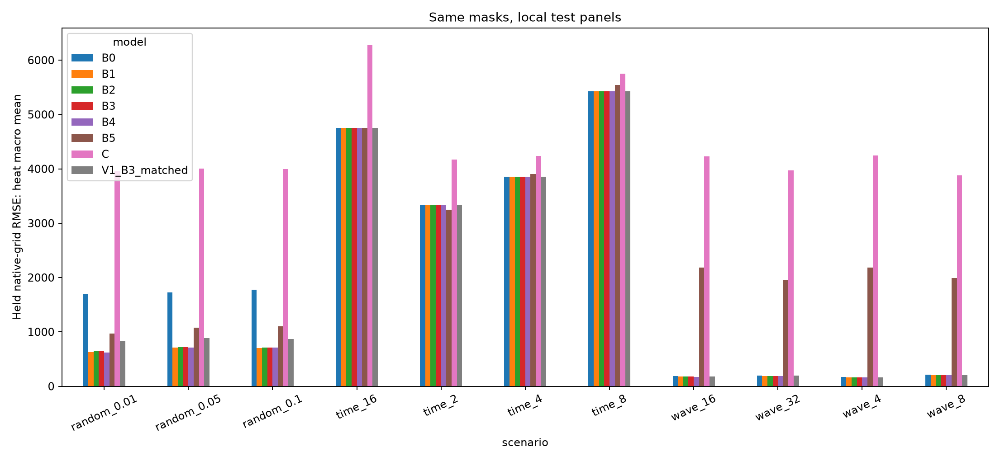

## 10 连续重构结果及模型验证

最终全炉函数为固定秩鲁棒潜变量的网格及锁定的线性插值，而不是提前指定的“鲁棒B样条”。它改变有效观测：这既可能去噪也可能损伤真实窄峰，下面的有效点RMSE是描述性保真代价而不是独立预测误差。函数使用每炉真实坐标，不做外推；三维图没有绘图阶段截顶、补饱和下界或隐藏负值。
| heat_id | model | converged | valid_observation_rmse_not_prediction | masked_fraction | saturated_count | saturated_lower_violation | grid_negative_fraction |
|---|---|---|---|---|---|---|---|
| 6B03205 | B2 | True | 182.21 | 0.00042411 | 0 | 0 | 0 |
| 6B03206 | B2 | True | 161.07 | 0.00092785 | 13 | 0 | 0 |
| 6B03270 | B2 | True | 104.5 | 0.0007983 | 0 | 0 | 0 |
| 6B03271 | B2 | True | 120.03 | 0.00071799 | 10 | 0 | 0 |
| 6C02057 | B2 | False | 322.27 | 0.0057456 | 4168 | 0.77327 | 0 |
| 6C02058 | B2 | False | 558.09 | 0.0046157 | 5805 | 0.9509 | 1.1276e-05 |
| 6C02059 | B2 | True | 247.16 | 0.0026217 | 100 | 0.42 | 0 |
| 6C02060 | B2 | True | 273.63 | 0.0029784 | 326 | 0.3589 | 0 |
| 6C02107 | B2 | False | 433.08 | 0.0030945 | 2110 | 0.70664 | 0 |
| 6C02108 | B2 | False | 381.22 | 0.0034497 | 2273 | 0.72327 | 0 |

| heat_id | median_raw_peak_relative_change | p95_raw_peak_relative_change | worst_unsaturated_raw_peak_relative_change | worst_time | not_clean_ground_truth |
|---|---|---|---|---|---|
| 6B03205 | 0.03608 | 0.29011 | 0.73332 | 473.5 | True |
| 6B03206 | 0.02069 | 0.14388 | 0.59354 | 511.5 | True |
| 6B03270 | 0.017614 | 0.098928 | 0.4292 | 508 | True |
| 6B03271 | 0.01644 | 0.098371 | 0.3236 | 71.5 | True |
| 6C02057 | 0.021512 | 0.17269 | 0.4539 | 24 | True |
| 6C02058 | 0.087401 | 0.60544 | 2.2888 | 445.5 | True |
| 6C02059 | 0.022404 | 0.17953 | 0.47694 | 247.5 | True |
| 6C02060 | 0.016249 | 0.19469 | 0.56134 | 376.5 | True |
| 6C02107 | 0.027073 | 0.16741 | 0.51418 | 76.5 | True |
| 6C02108 | 0.015477 | 0.10751 | 0.49929 | 539.5 | True |

6C02058在t=445.5s相对于原始谱的峰值变化达到228.9%，仍出现与V1纯潜变量类似的人工峰风险。原始观测不是无噪声真值，但这种大幅新结构不足以支持无条件用于正式论文的重构。B2/B3在离散隐藏点并列，却在有效观测保持和后续插值上不同；以单一开发NRMSE和低复杂度打破并列的协议没有保护这一物理要求，这是V2选择准则的明确局限。不能在看过本轮测试后静默改选B3并继续声称独立验证；应在后续版本预声明物理保真/峰值约束和新的独立检验。

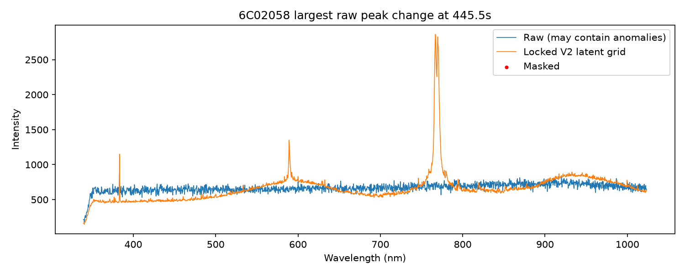

真实饱和不可辨识掩码、异常掩码、参数、潜变量和可调用函数均在data/{heat}_*.npz；大文件仅本地保留，可从只读输入和锁定源代码重建。

为检验局部结论，全原始矩阵上进行确认性测试：随机遮蔽仅在与开发不重叠的测试时间段，时间缺失完整覆盖所有波长，波长带覆盖测试时段的三个预设区域。B0与B2均跑两种子，V1同掩码对照跑811种子；配对比较必须仅取共同种子。确认结果不重新选择模型。下表为对应模型的逐炉场景宏平均：
| scenario | B0 | B2 | V1_B3_matched |
|---|---|---|---|
| random_0.01 | 2018 | 281.09 | 223.04 |
| random_0.05 | 2066.3 | 285.05 | 270.09 |
| random_0.1 | 2118.5 | 289.56 | 319.37 |
| time_16 | 6757.3 | 6752.7 | 6824.2 |
| time_2 | 5109.9 | 5097.4 | 5246 |
| time_4 | 6133.6 | 6128.3 | 5927.1 |
| time_8 | 6452.3 | 6447.2 | 6302.4 |
| wave_16 | 3295.4 | 175.02 | 1282.8 |
| wave_32 | 3326.5 | 310.33 | 1298.6 |
| wave_4 | 3329.2 | 172.85 | 1276.3 |
| wave_8 | 3303.2 | 172.29 | 1281.5 |

| scenario | B0 | B2 | V1_B3_matched |
|---|---|---|---|
| random_0.01 | 2006.5 | 314.78 | 223.04 |
| random_0.05 | 2065.7 | 274.58 | 270.09 |
| random_0.1 | 2115.4 | 288.9 | 319.37 |
| time_16 | 6830.2 | 6823.7 | 6824.2 |
| time_2 | 5251.7 | 5244.7 | 5246 |
| time_4 | 5931.1 | 5927 | 5927.1 |
| time_8 | 6308.5 | 6302.4 | 6302.4 |
| wave_16 | 3295.4 | 175.02 | 1282.8 |
| wave_32 | 3326.5 | 310.33 | 1298.6 |
| wave_4 | 3329.2 | 172.85 | 1276.3 |
| wave_8 | 3303.2 | 172.29 | 1281.5 |

上一个补充表限定共同种子811，才是V1与V2的严格配对比较；前表B0/B2包含两种子，不能逐格与仅811的V1解释成配对差值。

全矩阵共同种子811、场景等权的宏平均RMSE，V1为2750.13、B2为2364.22，下降约14.0%，主要来自波长带补全。随机1%却从223.04恶化到314.78，完整时间段的改进极小。这些相反结果与人工峰风险一起说明：整体平均误差改善不能支持全场景或物理保真的优越性。

完整矩阵连续降采样另提供250行确认数据：四种共同清洗网格方法，加“锁定B2补全+锁定线性插值”组合。该确认覆盖原始历史开发时段，不能取代严格分离的局部主测试，也不用于调参。组合方法和仅清洗网格插值的差异反映潜变量修改有效点带来的代价。
| scenario | method | mean | std |
|---|---|---|---|
| time_stride_2 | cubic | 4031.9 | 1622.7 |
| time_stride_2 | linear | 3934.3 | 1561.5 |
| time_stride_2 | locked_completion_plus_locked_interpolation | 3934 | 1565 |
| time_stride_2 | pchip | 3913.6 | 1547 |
| time_stride_2 | tensor_bspline | 4031.9 | 1622.7 |
| time_stride_3 | cubic | 5030.9 | 2026.9 |
| time_stride_3 | linear | 4743.5 | 1934.9 |
| time_stride_3 | locked_completion_plus_locked_interpolation | 4748.3 | 1941.7 |
| time_stride_3 | pchip | 4791.8 | 1932.1 |
| time_stride_3 | tensor_bspline | 5030.9 | 2026.9 |
| time_stride_4 | cubic | 5803.4 | 2477.7 |
| time_stride_4 | linear | 5371.5 | 2281.2 |
| time_stride_4 | locked_completion_plus_locked_interpolation | 5380 | 2291.4 |
| time_stride_4 | pchip | 5460.1 | 2304.1 |
| time_stride_4 | tensor_bspline | 5803.4 | 2477.7 |
| wave_stride_2 | cubic | 240.65 | 93.636 |
| wave_stride_2 | linear | 216.4 | 79.278 |
| wave_stride_2 | locked_completion_plus_locked_interpolation | 297.6 | 144.18 |
| wave_stride_2 | pchip | 217.78 | 78.969 |
| wave_stride_2 | tensor_bspline | 240.65 | 93.636 |
| wave_stride_3 | cubic | 269.24 | 103.88 |
| wave_stride_3 | linear | 244.69 | 90.125 |
| wave_stride_3 | locked_completion_plus_locked_interpolation | 309.7 | 150.39 |
| wave_stride_3 | pchip | 250.04 | 92.426 |
| wave_stride_3 | tensor_bspline | 269.24 | 103.88 |

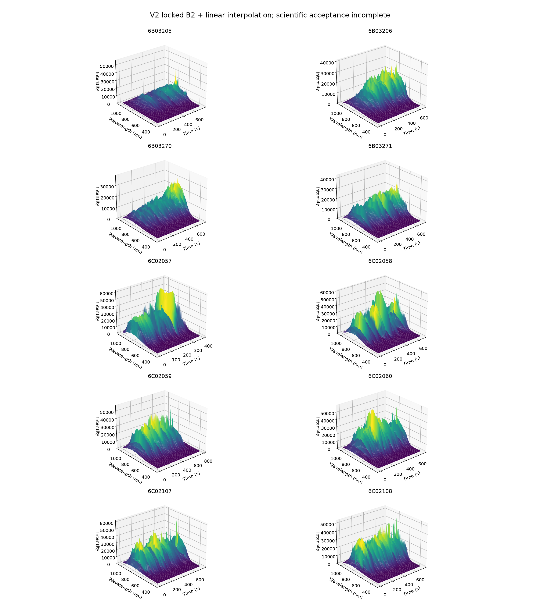

十炉三维图：

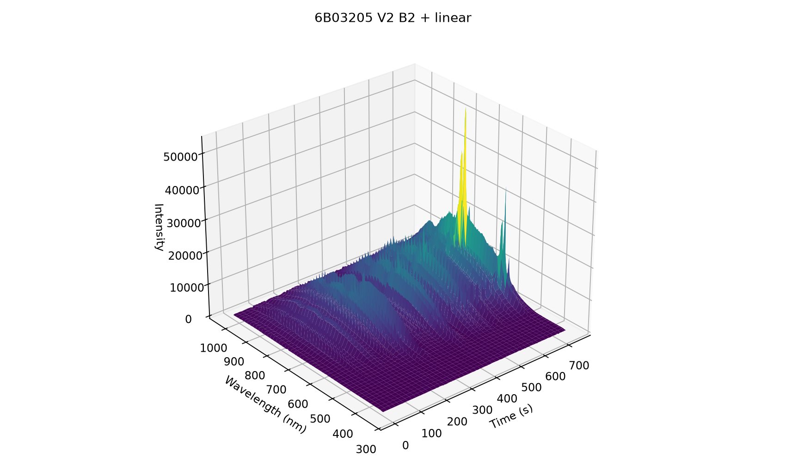

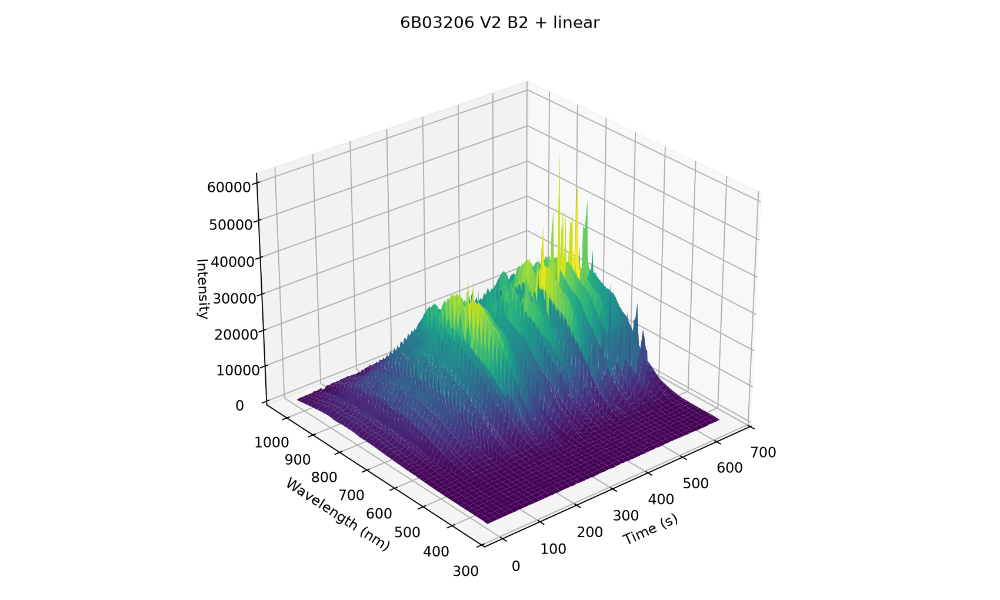

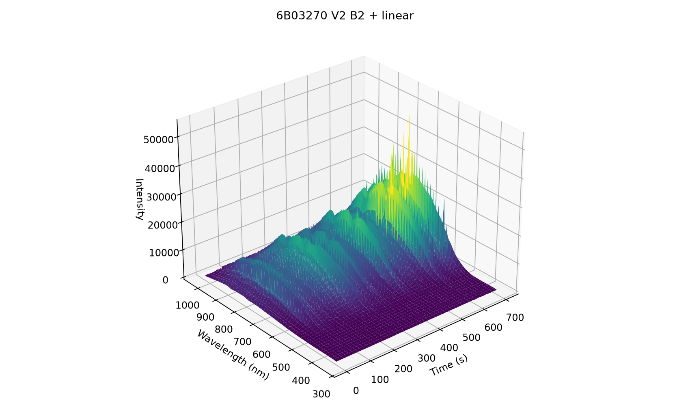

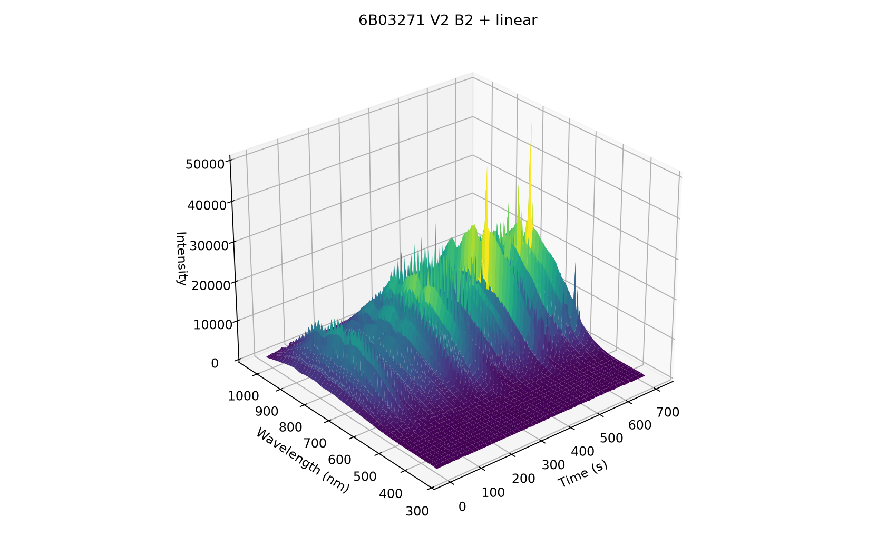

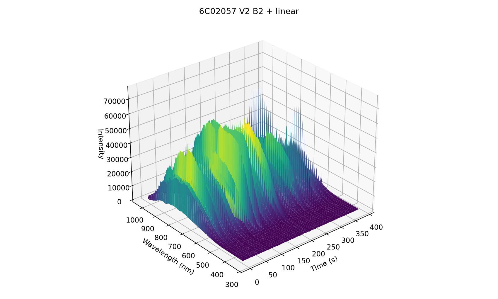

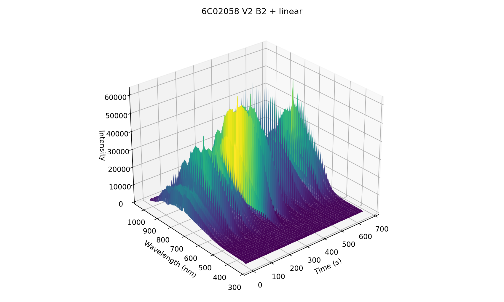

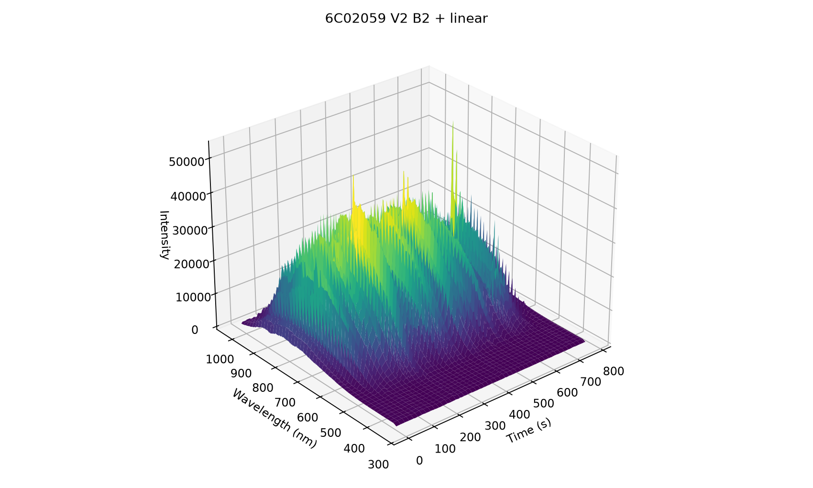

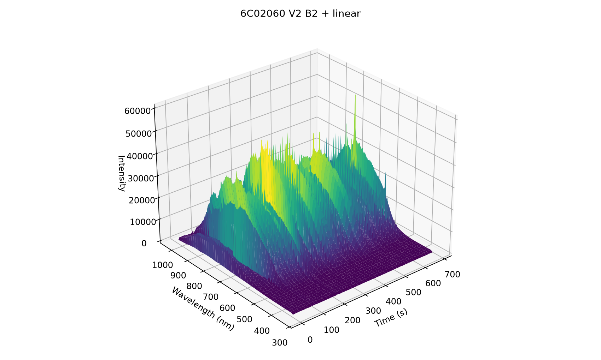

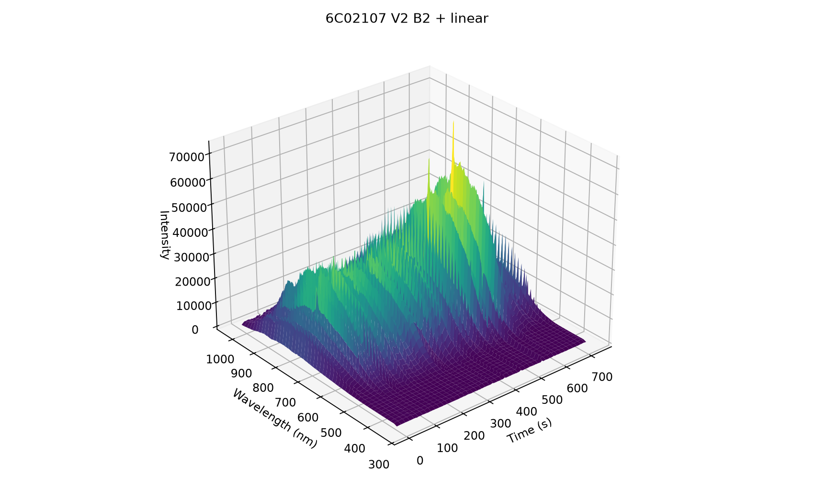

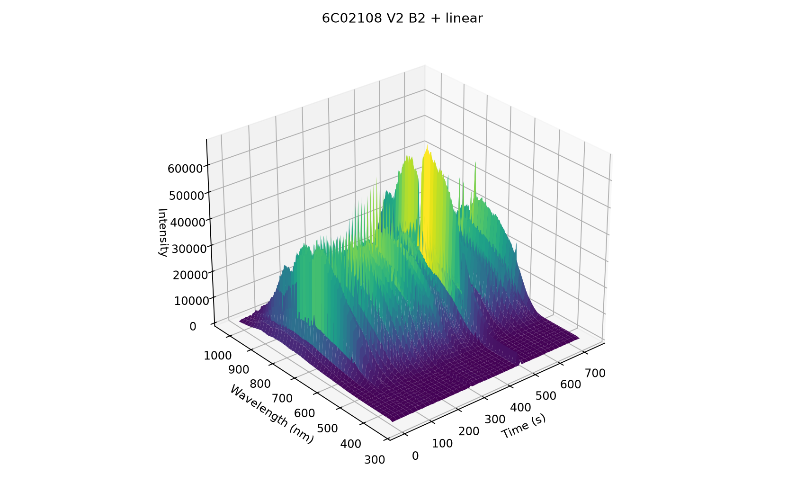

## 11 敏感性分析与模型局限

本轮完成工程和实验交付，但不能宣称已满足所有科学性能要求。主要未解决问题：

1. 整帧、持续整列、短块异常的识别可靠性不足；没有真实仪器异常标签，人工实验的可迁移性有限。
2. B5不稳定改善，整段时间缺失仍难；缺失内部的快速变化不可凭正则唯一识别。
3. B2在少量低亮度原始网格点输出负值，未做事后截断；有效观测修改与窄峰保持存在取舍，饱和软/硬方案虽改善人工截顶，却没有被开发整体评分选为最终模型。真实上量程部分仍可能违反条件下界，不虚构恢复峰高或上置信界。
4. 四炉最终B2拟合未达锁定停止准则；预算审计显示更多迭代改善有限。目标回溯不意味着非凸全局最优。
5. 原始参考含噪声，0<Y<64000筛选造成条件性；NRMSE按评分值q95−q05归一化，在低亮度小动态范围片段可能放大相对误差。故同时报告原始RMSE、MAE、保留比例与更宽未饱和参考。
6. 主实验是分层局部原生片段；全炉确认和最终重拟合不能制造新的独立炉次。时间与波长区域部分混杂，十炉全部来自现有数据，无法保证跨炉型/仪器泛化。
7. 线性函数连续但不全局可微；三次/张量B样条表达等价。最终选择仅覆盖预设有限候选，不能证明方法类别的全局最优。
8. 两篇SIAM PCHIP原文仍未取得合法作者/出版社全文；V13/V14/V17已获取公开全文并核读核心方法，未声称逐行复核全部证明。原R01–R12未获取全文的缺口保留。V17正确DOI为iau006，原给定iau004的错配记录保存。

新增文献和原始方法边界见[文献索引](../references/README.md)。V1与V2联合测试37项通过（68.70s）；测试覆盖源文件不变、真实十炉读取、梯度差分、掩码独立、B2/B3关系、连续坐标查询与边界、显式凸下界及结果数量。首次失败是空截顶参考条件的测试断言错误，已修复并保留首次日志；科学性能未达标的事实没有修改。代码测试通过不代表科学验收通过。

代码、CSV、锁文件、模型公式及本报告共同构成可审查结果；未来改进应启用新的实验版本及新的独立测试，不能在已打开的V2测试上继续调参再宣称独立。
