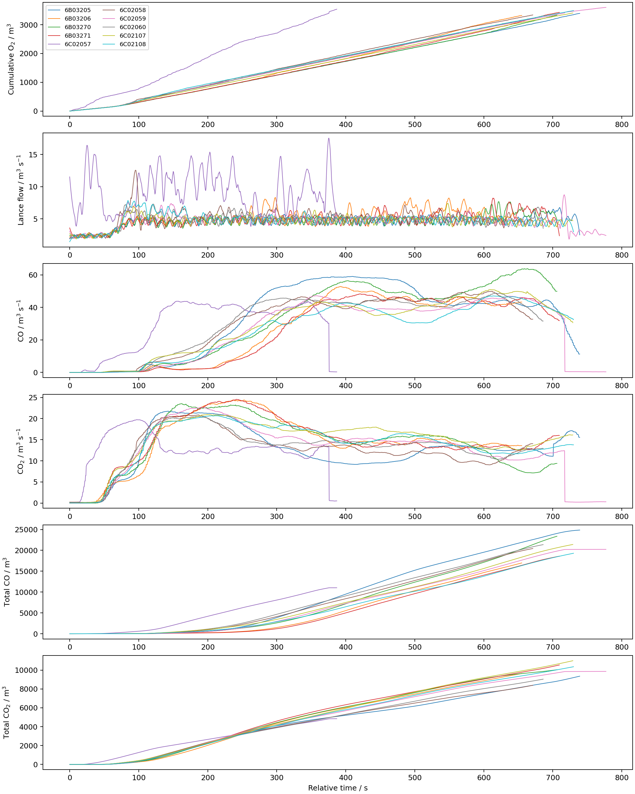
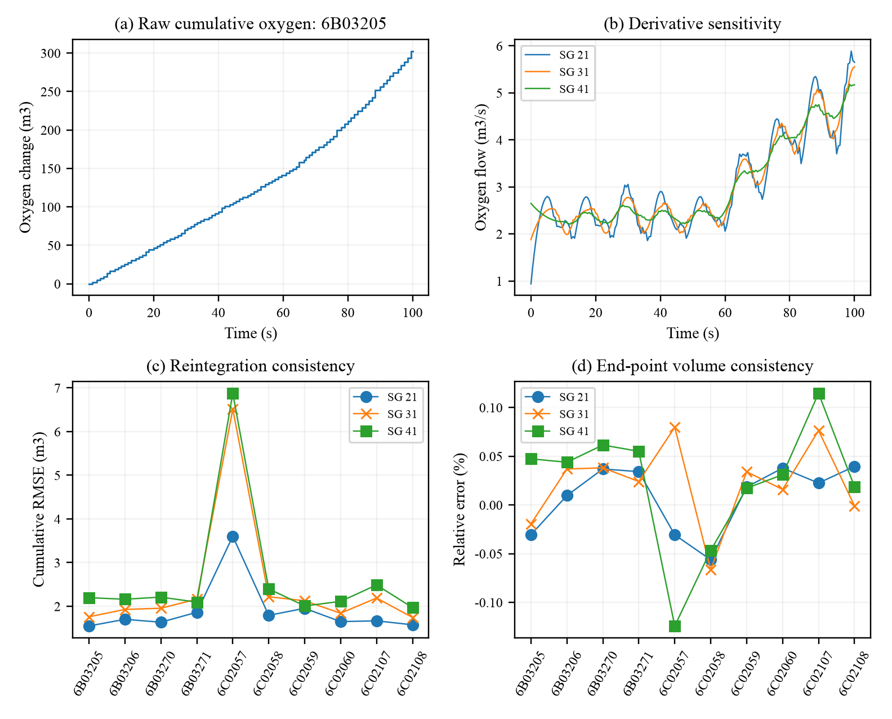
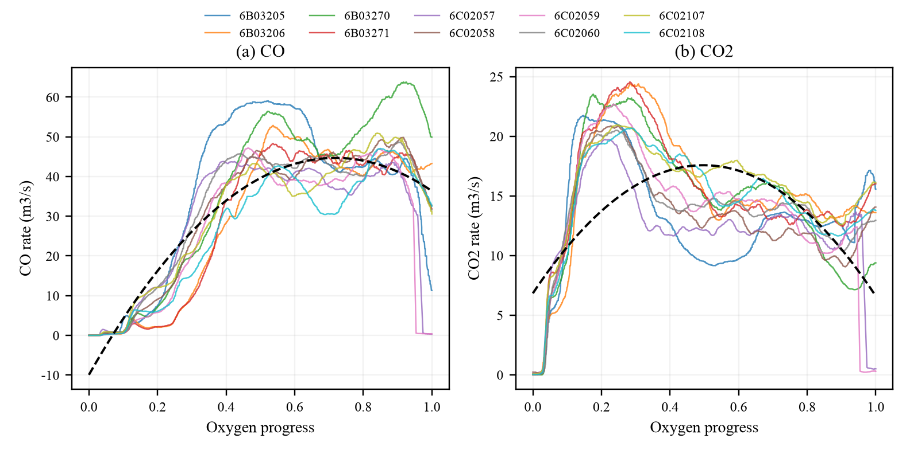
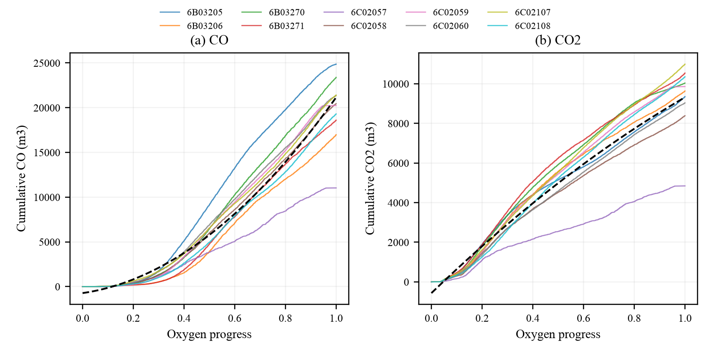
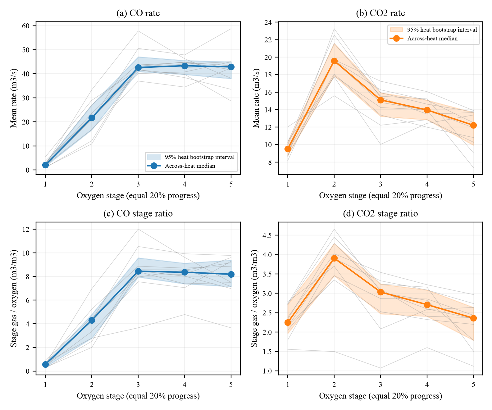
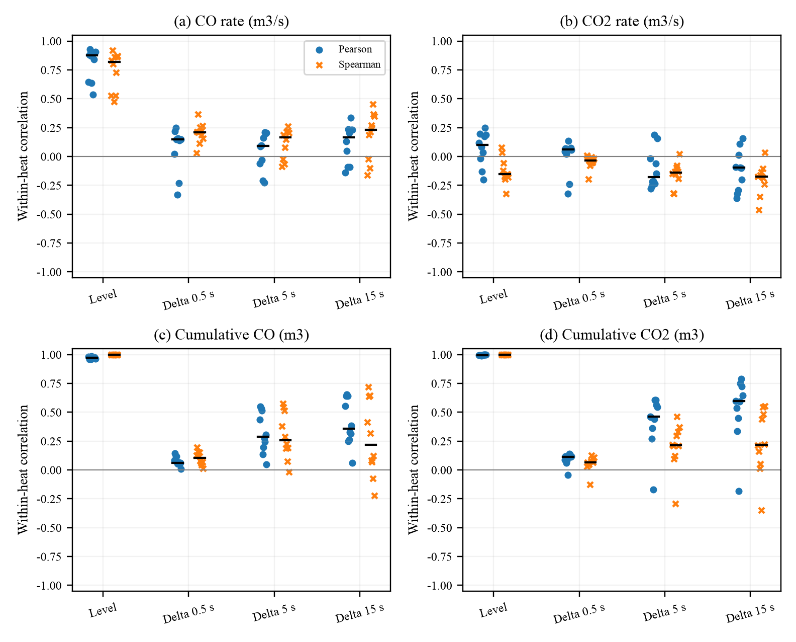

# 基于稳健重构的转炉工艺量计算与烟气响应分析

针对累计耗氧量与烟气观测中的异常和离散更新，采用稳健重构、平滑微分及数值积分建立六类工艺曲线，并从耗氧进程和局部响应两个尺度分析供氧与排放的关系。

## 6.1 工艺变量与连续信号重构

采用附件1至附件10提供的十炉炼钢工艺数据，以0.5 s为时间采样间隔，提取累计耗氧量、CO和CO₂瞬时体积流量三个变量。对第 \(h\) 炉，令 \(t_i=0.5(s_i-s_0)\)，以 \(O_h(t)\) 表示累计耗氧量，\(C_{g,h}(t)\) 表示气体 \(g\in\{\mathrm{CO},\mathrm{CO_2}\}\) 的瞬时体积流量，单位分别为m³和m³/s。十炉记录时长为387–777 s，分别在各自观测区间内重构。

表1 十炉数据规模及耗氧、排放总量

| 炉号 | 点数 | 时长 s | 耗氧增量 m³ | CO总量 m³ | CO₂总量 m³ |
|---|---|---|---|---|---|
| 6B03205 | 1479 | 739 | 3391 | 2.487e+04 | 9350 |
| 6B03206 | 1311 | 655 | 3319 | 1.698e+04 | 9634 |
| 6B03270 | 1413 | 706 | 3329 | 2.339e+04 | 1.003e+04 |
| 6B03271 | 1420 | 709.5 | 3425 | 1.861e+04 | 1.054e+04 |
| 6C02057 | 775 | 387 | 3537 | 1.103e+04 | 4843 |
| 6C02058 | 1343 | 671 | 3339 | 2.044e+04 | 8385 |
| 6C02059 | 1555 | 777 | 3601 | 2.024e+04 | 9858 |
| 6C02060 | 1373 | 686 | 3307 | 2.137e+04 | 9035 |
| 6C02107 | 1459 | 729 | 3405 | 2.141e+04 | 1.099e+04 |
| 6C02108 | 1461 | 730 | 3488 | 1.93e+04 | 1.035e+04 |

对每个工艺序列 \(x_i\)，在9点邻域 \(\mathcal N_i\) 中计算中位数与稳健尺度：

\[
m_i=\operatorname{median}_{j\in\mathcal N_i}x_j,\qquad
\sigma_i=1.4826\operatorname{median}_{j\in\mathcal N_i}|x_j-m_i|.
\]

当 \(|x_i-m_i|>6\sigma_i\) 时标记异常；局部尺度为零时，结合两侧平台和邻域尺度识别孤立尖峰，非有限值及负值同时剔除。利用其余观测构造PCHIP连续函数 \(\widehat O_h(t)\) 和 \(\widehat C_{g,h}(t)\)。该插值保持节点取值及局部单调形态，避免普通三次样条在平台和突变附近产生额外过冲，并对重构值施加非负约束。

90组孤立尖峰注入试验的平均召回率为96.5%。在2 s低幅烟气响应试验中，CO与CO₂的峰值保留中位数由采集后的86.9%和87.5%降至清洗后的28.6%和37.7%。缩小至5点窗口虽能改善短峰保留，但另一组20个已知强孤立尖峰仅检出15个，9点窗口全部检出。故保留9点方案用于连续曲线与累计排放，并在时滞分析中考察短响应损失；具体注入条件见补充材料。

## 6.2 氧枪流量与烟气排放量

氧枪流量由累计耗氧量的平滑导数估计：

\[
\widehat q_h(t_i)=\max\left\{0,\operatorname{SGDeriv}_{31,3}[\widehat O_h](t_i)\right\}.
\]

采用31点、三阶Savitzky–Golay局部多项式，窗口首末跨度为15 s。原始累计耗氧记录约一半相邻值重复，正增量中位数约4.73 m³；直接差分会将离散更新放大为流量脉冲。平滑窗口因而需要兼顾动态保留与更新波动抑制。表2比较31点与11点方案的两项受控结果。

表2 SG导数估计的短峰保留与伪波动权衡

| 导数估计 | 4 s供氧脉冲峰值保留中位数 / % | 恒定流量伪波动中位数 / % |
|---|---|---|
| 31点SG | 35.0 | 1.6 |
| 11点SG | 77.3 | 11.8 |

表注：两项指标来自不同受控条件，分别衡量4 s脉冲峰值保留与恒定流量下的伪波动；后者为估计流量标准差与真流量之比。采集保持机制为实验假设，详细设置见补充材料。

31点SG的恒定流量伪波动中位数为1.6%，11点SG虽提高短峰保留率，却使伪波动增至11.8%。综合流量稳定性与累计量一致性，选取31点SG进行流量重构，十炉反积分相对误差绝对值均小于0.08%。该估计用于连续流量与总量分析，不保证短瞬态时序准确。

烟气累计排放量定义为

\[
\widehat E_{g,h}(t)=\int_0^t\widehat C_{g,h}(u)\,\mathrm du,
\]

在采样节点采用复合梯形公式：

\[
\widehat E_{g,h}(t_i)=\sum_{j=1}^{i}
\frac{\widehat C_{g,h}(t_{j-1})+\widehat C_{g,h}(t_j)}{2}(t_j-t_{j-1}).
\]

累计量从记录起点计，单位为m³，十炉末端总量见表1。图1给出氧枪流量、累计耗氧量、CO与CO₂瞬时流量及累计排放量六类连续曲线；图2展示累计记录的更新结构和平滑导数的尺度差异。

图1 十炉氧枪流量、累计耗氧量与两种烟气的瞬时流量及累计排放量

图2 累计耗氧记录的离散更新特征与不同SG窗口下的流量估计

## 6.3 累计耗氧量与四类烟气变量的关系

以累计耗氧量为自变量，分别研究CO、CO₂瞬时流量及其累计排放量。先逐炉计算Pearson与Spearman系数，再汇总炉间范围，避免记录长度和炉际总量差异主导统计。为识别累计变量共同增长的影响，构造末端总排放量相同的恒定速率参照

\[
E^{(0)}_{g,h}(t)=E_{g,h}(T_h)\frac{t}{T_h}.
\]

表3 四类耗氧关系的相关系数及恒定排放参照

| 关系 | Pearson范围 | Spearman范围 | 恒定排放参照Pearson范围 |
|---|---|---|---|
| 耗氧量—CO瞬时流量 | 0.537–0.930 | 0.474–0.917 | 不适用 |
| 耗氧量—CO₂瞬时流量 | -0.199–0.249 | -0.325–0.080 | 不适用 |
| 耗氧量—CO累计排放 | 0.958–0.985 | 1.000–1.000 | 0.997–1.000 |
| 耗氧量—CO₂累计排放 | 0.992–0.999 | 1.000–1.000 | 0.997–1.000 |

CO瞬时流量与累计耗氧量的Pearson系数为0.537–0.930，表现出明显的同向进程关系；CO₂相应为−0.199–0.249，单一线性关系较弱。两类累计排放与耗氧量高度相关，但恒定排放参照也达到0.997–1.000，表明高累计相关本身不足以区分共同进程与动态响应，也不能据此确定响应时滞。图3和图4分别展示瞬时流量与累计排放的关系。

图3 耗氧进度与CO、CO₂瞬时流量

图4 耗氧进度与CO、CO₂累计排放

进一步在不重叠的0.5、5和15 s区间计算 \(\Delta O\) 与 \(\Delta C_g\)、\(\Delta E_g\) 的相关。累计量在0.5 s尺度上的增量相关明显低于原值相关；聚合至15 s后，CO与CO₂累计增量的Pearson炉间中位数分别为0.356和0.596，但逐炉仍有明显差异（图6、附录表S1）。因此，排放与供氧的关联包含时间尺度差异，原值相关不足以描述局部动态。

为比较不同炉次的排放进程，定义无量纲耗氧进度

\[
p_h(t)=\frac{\widehat O_h(t)-\widehat O_h(0)}{\widehat O_h(T_h)-\widehat O_h(0)},
\]

将其划分为五个等耗氧阶段。每段以排放积分增量除以持续时间得到平均流量，以 \(\Delta E_g/\Delta O\) 得到排放与耗氧的表观体积比。阶段边界由累计耗氧量插值定位，边界处同氧量平台取最后时刻。

表4 五个等耗氧阶段的烟气排放统计

| 气体 | 等耗氧阶段 | 阶段平均流量中位数 m³/s | 95%整炉重采样区间 | 阶段排放/耗氧中位数 m³/m³ |
|---|---|---|---|---|
| CO | 1 | 2.105 | [1.516, 2.928] | 0.5679 |
| CO | 2 | 21.7 | [16.726, 27.044] | 4.292 |
| CO | 3 | 42.61 | [40.889, 47.041] | 8.446 |
| CO | 4 | 43.33 | [39.721, 45.517] | 8.361 |
| CO | 5 | 42.86 | [37.973, 44.977] | 8.19 |
| CO2 | 1 | 9.503 | [8.771, 10.255] | 2.249 |
| CO2 | 2 | 19.58 | [17.862, 21.568] | 3.908 |
| CO2 | 3 | 15.11 | [13.225, 15.929] | 3.034 |
| CO2 | 4 | 13.96 | [12.844, 15.079] | 2.709 |
| CO2 | 5 | 12.2 | [9.923, 13.660] | 2.359 |

CO阶段平均流量中位数由第一阶段2.11 m³/s升至第三阶段42.61 m³/s，随后保持高位；CO₂在第二阶段达到19.58 m³/s，之后下降。这一先升后降形态解释了CO₂整炉线性相关较弱的原因。表中区间以整炉为重采样单位进行2000次Bootstrap，避免把相邻时间点作为独立样本。

在 \(p\in[0,1]\) 内，用线性与二次多项式描述上述进程：

\[
f_1(p)=c_0+c_1p,\qquad f_2(p)=c_0+c_1p+c_2p^2.
\]

合并拟合时令每炉总权重相等，并以留一炉次法评价跨炉趋势。由于耗氧进度使用末端耗氧总量，该检验针对离线进程描述。系数见附录表S2，验证结果见表5。

表5 线性与二次耗氧趋势的留一炉次验证

| 关系 | 次数 | 留一炉次宏平均MAE | 留一炉次宏平均R² | 测试R²>0炉数 |
|---|---|---|---|---|
| 耗氧量—CO瞬时流量 | 1 | 8.923 | 0.5956 | 10 |
| 耗氧量—CO瞬时流量 | 2 | 6.204 | 0.7915 | 10 |
| 耗氧量—CO₂瞬时流量 | 1 | 4.212 | -0.04367 | 2 |
| 耗氧量—CO₂瞬时流量 | 2 | 3.726 | 0.3087 | 9 |
| 耗氧量—CO累计排放 | 1 | 2043 | 0.7664 | 9 |
| 耗氧量—CO累计排放 | 2 | 1424 | 0.8076 | 9 |
| 耗氧量—CO₂累计排放 | 1 | 769.1 | 0.5675 | 9 |
| 耗氧量—CO₂累计排放 | 2 | 757.6 | 0.5704 | 9 |

CO瞬时流量的二次趋势将宏平均MAE由8.923降至6.204 m³/s，R²由0.596提高至0.792；CO₂的R²由−0.044提高至0.309，正R²炉数由2增至9。二次项有效刻画了CO₂阶段转折。累计CO₂的两种趋势MAE接近，因此仍以积分结果确定累计排放，多项式只用于解释观测区间内的趋势。

图5 五个等耗氧阶段的烟气流量与排放耗氧体积比

图6 四类耗氧关系的原值与多尺度增量相关

## 6.4 不同氧枪流量下的烟气响应时滞

以供氧变化与随后烟气变化的局部对应关系估计时滞。对 \(\widehat q_h\) 和 \(\widehat C_{g,h}\) 分别作一阶差分，并减去21点居中滚动中位数，得到动态分量 \(u_h\) 与 \(v_{g,h}\)。在121点窗口 \(W_k\) 内计算

\[
\widehat\tau_{g,h,k}=\underset{\tau\in\{0,0.5,\ldots,60\}}{\arg\max}
\operatorname{corr}\!\left(u_h(t),v_{g,h}(t+\tau)\right)_{t\in W_k}.
\]

正迟延表示烟气变化晚于供氧变化。窗口首末跨度60 s，中心每2.5 s移动一次。要求源窗口与未平移烟气窗口的动态标准差均不低于各自全炉标准差的5%，并保留最大相关系数不低于0.35、与相隔至少2.5 s竞争峰的相关系数差不低于0.05、且最优值不在搜索端点的估计。峰宽与显著性用于诊断，不参与筛选。

十炉共有2241个候选中心，CO通过13个，CO₂通过11个，比例分别为0.58%和0.49%。以全部候选中心的氧枪流量三分位数划分低、中、高流量，分层边界约为4.652和5.199 m³/s，两种气体使用相同边界。表6给出各层时滞的中位数、范围与覆盖情况。

表6 不同氧枪流量下的候选烟气时滞

| 流量层 | 中心流量区间 m³/s | 气体 | 候选时滞中位数 s | 范围 s | 合格窗口数 | 覆盖炉数 |
|---|---|---|---|---|---|---|
| 低 | [1.988, 4.652) | CO | 27.5 | 6.0–35.0 | 11 | 5 |
| 低 | [1.988, 4.652) | CO2 | 7.5 | 7.5–7.5 | 4 | 2 |
| 中 | [4.652, 5.199) | CO | 7.5 | 7.5–7.5 | 1 | 1 |
| 中 | [4.652, 5.199) | CO2 | 15 | 7.5–22.5 | 2 | 2 |
| 高 | [5.199, 15.090] | CO | 40 | 40.0–40.0 | 1 | 1 |
| 高 | [5.199, 15.090] | CO2 | 36.5 | 7.5–36.5 | 5 | 1 |

表注：各项均为窗口级候选估计，尚未确认独立物理响应事件。

CO在低、中、高流量下的时滞中位数分别为27.5、7.5和40.0 s，CO₂分别为7.5、15.0和36.5 s。中、高流量的CO各仅有1个窗口；高流量两种气体均只覆盖同一炉。相邻窗口共享约95.9%的源数据，24个合格窗口对应的7个CO与5个CO₂源重叠组也不能作为12次独立响应。

在相同烟气注入与清洗条件下，4 s已知供氧脉冲直接叠加至流量序列时，时滞正确恢复数为1199/1200；先积分成累计耗氧量并经过重构链后，降至3/1200，表明短时动态信息的衰减显著影响时滞辨识。结合表6，CO与CO₂候选时滞均未呈现一致的单调递减关系。因此保留各流量区间的统计时滞估计，尚不建立统一的流量—时滞函数；第三问采用原始时间轴建立预测基线，避免不可靠的时滞修正引入额外误差。
